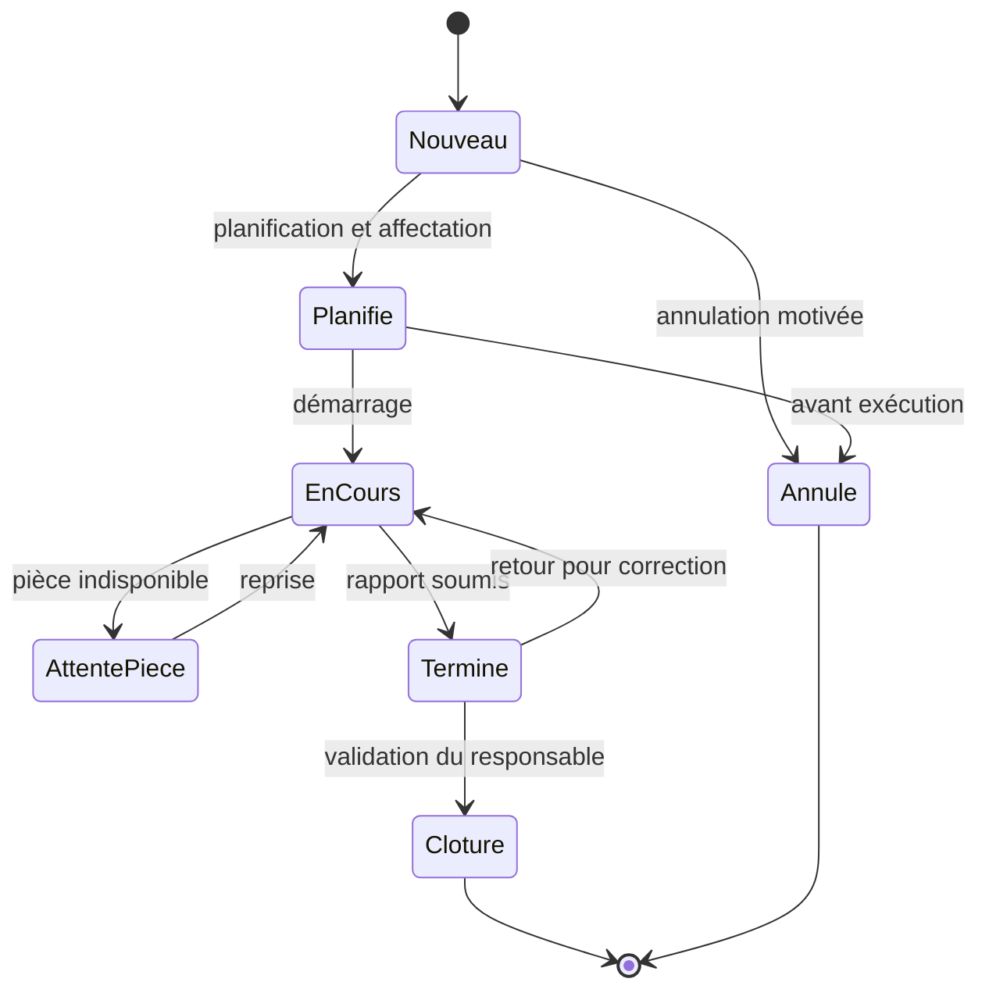
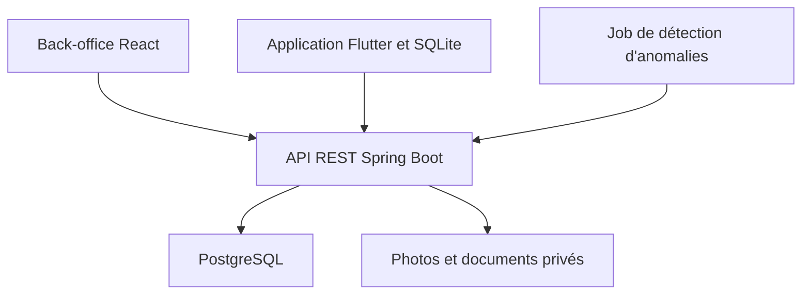

# Siyana

**GMAO pour PME industrielles avec application mobile hors ligne.**

> La maintenance connectée, même sans réseau.

Siyana est un projet de **Gestion de Maintenance Assistée par Ordinateur** destiné aux petites et moyennes entreprises industrielles. Il vise à centraliser le suivi des équipements, organiser les interventions correctives et préventives, gérer les pièces de rechange et mesurer les performances du service maintenance.

Son application mobile doit permettre aux techniciens de consulter leurs interventions et saisir leurs rapports dans les ateliers sans couverture réseau, puis de synchroniser leur travail à la reconnexion.

Le nom **Siyana** s'inspire du mot arabe **صيانة**, qui signifie « maintenance ».

**Statut : cadrage et conception.** Ce README présente le périmètre cible et les choix techniques du projet. Les fonctionnalités décrites sont à développer et à valider.

## Sommaire

- [Contexte et objectifs](#contexte-et-objectifs)
- [Fonctionnalités prévues](#fonctionnalités-prévues)
- [Utilisateurs et responsabilités](#utilisateurs-et-responsabilités)
- [Parcours de maintenance](#parcours-de-maintenance)
- [Application mobile hors ligne](#application-mobile-hors-ligne)
- [Architecture et technologies](#architecture-et-technologies)
- [Indicateurs et analyse](#indicateurs-et-analyse)
- [Organisation du dépôt](#organisation-du-dépôt)
- [Installation et lancement](#installation-et-lancement)
- [Feuille de route](#feuille-de-route)
- [Qualité et validation](#qualité-et-validation)
- [Documentation prévue](#documentation-prévue)
- [Cadre académique](#cadre-académique)
- [Contribution](#contribution)
- [Licence](#licence)

## Contexte et objectifs

Dans de nombreuses PME industrielles, la maintenance repose encore sur des fiches papier, des échanges informels et des fichiers Excel. Les informations sur les pannes, les interventions et les pièces consommées deviennent difficiles à retrouver et à exploiter.

Siyana vise à fournir un historique par équipement et un suivi partagé entre production, maintenance et magasin. Le projet doit notamment permettre de :

- Structurer le parc d'équipements par site et ligne de production.
- Tracer une intervention depuis le signalement jusqu'à la clôture.
- Planifier la maintenance préventive par calendrier ou compteur.
- Suivre les pièces consommées et les besoins de réapprovisionnement.
- Préserver le travail des techniciens lorsqu'ils n'ont pas accès au réseau.
- Calculer les coûts et indicateurs à partir de données métier vérifiables.

Le périmètre initial couvre **une PME avec plusieurs sites possibles**, un back-office web et une application Android développée avec Flutter.

## Fonctionnalités prévues

| Module | Périmètre cible |
|---|---|
| **Équipements** | Arborescence site/ligne/machine, fiches techniques, criticité, documents, QR codes, archivage et historique |
| **Interventions** | Demandes d'intervention, validation, ordres de travail, priorités, planification, affectation, rapports et clôture |
| **Maintenance préventive** | Plans calendrier ou compteur, relevés, checklists, échéances et génération automatique d'ordres de travail |
| **Pièces et stock** | Référentiel de pièces, mouvements, consommations par intervention, seuils d'alerte et demandes d'achat |
| **Mobile technicien** | Tâches téléchargées, scan QR, consultation locale, rapports, temps, pièces utilisées et photos hors ligne |
| **Pilotage** | MTBF, MTTR, disponibilités, coûts par équipement, suivi des retards et exports |

Un module complémentaire de **détection d'anomalies** doit signaler les équipements dont la fréquence de panne, la durée de réparation ou le coût évolue de façon inhabituelle.

## Utilisateurs et responsabilités

| Utilisateur | Responsabilités |
|---|---|
| **Opérateur de production** | Signaler un problème et suivre sa demande d'intervention |
| **Responsable maintenance** | Valider les demandes, planifier les interventions, affecter les techniciens, vérifier les rapports et clôturer les OT |
| **Technicien** | Consulter ses missions, réaliser les interventions et saisir ses rapports depuis l'application mobile |
| **Magasinier** | Gérer les pièces, valider les mouvements, traiter les consommations et suivre les réapprovisionnements |
| **Direction** | Consulter les indicateurs, la disponibilité et les coûts de maintenance |
| **Administrateur** | Gérer les comptes, les rôles, les sites et les référentiels |

Les droits doivent être contrôlés par l'API selon le rôle, le site et la ressource concernée. Les autorisations métier d'un administrateur sont attribuées explicitement.

## Parcours de maintenance

1. **Signalement :** un opérateur crée une demande d'intervention (DI) sur un équipement.
2. **Validation :** le responsable accepte ou rejette la demande avec une décision tracée.
3. **Planification :** un ordre de travail (OT) est créé, priorisé, daté et affecté.
4. **Exécution :** le technicien renseigne sa checklist, son diagnostic, les actions réalisées, les temps, les pièces et les photos.
5. **Vérification :** les consommations sont validées et le responsable contrôle le rapport.
6. **Clôture :** l'OT est clôturé et ses données alimentent l'historique et les indicateurs.

### Cycle de vie d'un ordre de travail

La remise en service d'une machine est enregistrée séparément de la clôture administrative de l'OT. Une même panne peut nécessiter plusieurs OT tout en restant un seul épisode de défaillance.

## Application mobile hors ligne

Le mode hors ligne constitue une exigence centrale du projet. Une première connexion en ligne permet d'authentifier le technicien et de télécharger ses données autorisées.

### Données accessibles sans connexion

- Ordres de travail affectés et consignes d'intervention.
- Fiches des équipements téléchargés et historique récent.
- Checklists et documents explicitement préparés pour le hors ligne.
- Brouillons, lignes de temps, relevés, consommations déclarées et photos locales.

### Principes de synchronisation prévus

| Mécanisme | Comportement attendu |
|---|---|
| **Persistance SQLite** | Une action confirmée localement reste disponible après redémarrage de l'application |
| **File d'opérations durable** | Chaque modification à transmettre est enregistrée avec ses dépendances et son état |
| **UUID et idempotence** | Une nouvelle tentative réseau conserve le même identifiant et ne produit pas de doublon |
| **Version des données** | Une modification incompatible avec la version serveur déclenche un conflit explicite |
| **Synchronisation incrémentale** | Le mobile récupère les nouveautés à partir du dernier curseur effectivement appliqué |
| **Photos différées** | Les images sont conservées dans le stockage privé du téléphone puis envoyées séparément |
| **Suivi utilisateur** | L'interface distingue les données locales, en attente, synchronisées et à résoudre |

La synchronisation doit pouvoir être déclenchée manuellement, à l'ouverture ou à la reprise de l'application, ainsi qu'au retour réseau lorsque l'application fonctionne. Les envois en arrière-plan dépendront des contraintes Android.

Une pièce utilisée hors ligne est d'abord une **consommation déclarée**. Sa disponibilité globale et son mouvement de stock sont validés côté serveur. En cas de pénurie ou de conflit, la déclaration est conservée pour arbitrage.

Les opérations de gestion des comptes, d'affectation et de clôture définitive nécessitent une validation en ligne. Une donnée jamais téléchargée ne peut pas être consultée hors ligne.

## Architecture et technologies

L'architecture cible repose sur une API REST organisée en modules métier, partagée par le back-office et l'application mobile. PostgreSQL conserve les données métier de référence ; SQLite conserve les données et opérations locales du technicien.

| Couche | Technologies prévues |
|---|---|
| Backend | Java 21, Spring Boot, Maven |
| Sécurité | Spring Security, JWT signés et sessions de renouvellement révocables |
| Persistance serveur | PostgreSQL, JPA/Hibernate et Flyway |
| Frontend web | React, TypeScript et Vite |
| Application mobile | Flutter, Dart et SQLite via sqflite |
| Contrat API | OpenAPI |
| Analyse de données | Python, pandas et scikit-learn |
| Déploiement | Docker Compose |
| Intégration continue | GitHub Actions |

Les versions exactes et fichiers de verrouillage seront fixés lors de l'initialisation des applications. Les photos et documents doivent être stockés dans un espace privé avec accès autorisé par l'API.

## Indicateurs et analyse

### Indicateurs métier

| Indicateur | Définition retenue pour la conception |
|---|---|
| **MTBF** | Temps de fonctionnement observé divisé par le nombre d'épisodes de panne de la période |
| **MTTR** | Durée active de réparation divisée par le nombre d'épisodes correctifs réparés, selon la cohorte définie |
| **Disponibilité modélisée** | MTBF / (MTBF + MTTR), lorsque les valeurs sont définies et comparables |
| **Disponibilité observée** | Temps de fonctionnement observé divisé par le temps de production prévu |
| **Coût de maintenance** | Main-d'œuvre validée et pièces consommées, valorisées à leurs tarifs historiques |

Le temps d'arrêt machine, le temps de réparation active et le temps de travail humain sont suivis séparément. Les périodes sans données suffisantes doivent être identifiées comme telles. La disponibilité modélisée et la disponibilité observée restent deux mesures distinctes.

### Détection d'anomalies

Le module prévu s'appuie sur une baseline métier et un modèle **Isolation Forest** pour analyser les historiques agrégés. Le tableau de bord doit afficher le score, la période analysée et les valeurs observées qui justifient une vérification.

En l'absence d'historique industriel exploitable, un générateur reproductible fournira des données synthétiques clairement identifiées. L'évaluation comparera la baseline et le modèle sur une période distincte, avec des anomalies injectées connues.

Un score d'anomalie est une aide à l'analyse : il n'est pas présenté comme une probabilité certifiée de panne prochaine.

## Organisation du dépôt

Organisation cible, à mettre en place pendant le développement :

| Chemin | Contenu prévu |
|---|---|
| `backend/` | API REST, règles métier, sécurité, synchronisation et migrations |
| `web/` | Back-office React et tableaux de bord |
| `mobile/` | Application Flutter et persistance SQLite |
| `analytics/` | Génération des données, variables, modèle et évaluation |
| `docs/` | Cahier des charges, conception, protocole de synchronisation et guides |
| `infra/` | Configuration Docker et déploiement |
| `.github/workflows/` | Vérifications et builds automatisés |

Les principaux modules backend prévus sont `identity`, `assets`, `workorders`, `preventive`, `inventory`, `sync` et `reporting`.

## Installation et lancement

Le projet étant en phase de conception, aucune procédure de lancement n'est encore validée. Les commandes exactes seront ajoutées avec le code, les migrations et la configuration de chaque application.

### Environnement à préparer

- Git.
- JDK 21 et Maven, ou le wrapper fourni par le futur backend.
- Node.js et le gestionnaire de paquets retenu pour le web.
- Flutter avec le SDK Android et un émulateur ou un téléphone Android.
- Docker avec Docker Compose pour l'environnement serveur.
- Python et un environnement virtuel pour le module d'analyse.

La procédure finale devra couvrir la configuration d'environnement, le démarrage de PostgreSQL et de l'API, l'application des migrations, le chargement des données de démonstration, puis le lancement du web et du mobile. Les secrets et identifiants réels resteront hors du dépôt.

## Feuille de route

Le calendrier de référence couvre **14 semaines**. L'hypothèse de charge est de deux développeurs, chacun avec 24 h de travail planifié et 6 h de réserve par semaine. Les dates seront adaptées au calendrier officiel du PFA.

| Période | Travail prévu | Jalon |
|---|---|---|
| **S1–S2** | Étude de l'existant, entretiens, besoins, règles métier et critères de recette | Cahier des charges prêt à validation |
| **S3–S4** | Modélisation, maquettes, socle technique et prototype de synchronisation | Preuve de persistance et de reprise hors ligne |
| **S5–S7** | Équipements, DI/OT, affectation, premiers plans préventifs et stock | Démonstration web intégrée |
| **S8–S10** | Compteurs, exécution mobile, photos, reprise réseau et conflits | Démonstration hors ligne complète |
| **S11–S12** | Indicateurs, coûts, IA, recette, déploiement et restauration | Version fonctionnelle complète |
| **S13–S14** | Stabilisation, documentation, rapport et répétitions | Livraison et soutenance |

Les notifications push, iOS, Metabase, l'IoT et la gestion de plusieurs entreprises clientes constituent des évolutions possibles après la couverture du périmètre initial.

## Qualité et validation

Les vérifications prévues portent en priorité sur les règles métier, les droits, l'intégrité des données et le fonctionnement hors ligne.

### Scénarios essentiels

- Saisir un rapport en mode avion, fermer l'application et retrouver les données après relance.
- Répéter une opération après une réponse réseau perdue sans créer de doublon.
- Traiter deux modifications concurrentes d'un même OT sans écrasement silencieux.
- Reprendre un envoi de photo interrompu sans multiplier les pièces jointes.
- Valider deux consommations concurrentes sans autoriser un stock négatif.
- Relancer un job préventif sans dupliquer les occurrences.
- Vérifier les indicateurs et coûts sur un jeu de calcul connu.
- Refuser l'accès à une intervention ou un fichier hors du périmètre de l'utilisateur.
- Empêcher l'accès au cache d'un autre compte sur le même téléphone.
- Restaurer ensemble la base de données et les fichiers dans un environnement vide.

### Outils envisagés

| Périmètre | Vérifications |
|---|---|
| Backend | JUnit, tests Spring Boot et intégration avec PostgreSQL |
| Web | Vérification TypeScript, tests ciblés et parcours critiques avec Playwright |
| Mobile | Tests Dart/Flutter et recette sur appareil Android réel |
| Analyse | Reproductibilité, séparation temporelle des données et comparaison à une baseline |
| Livraison | Builds automatisés, migrations et procédure de restauration |

Les résultats de tests et les performances seront publiés après mesure. Ce document ne revendique pas de couverture de tests ni de fonctionnalités déjà livrées.

## Documentation prévue

Le [planning complet sur 14 semaines](docs/Planning_GMAO_PME_14_Semaines.md) détaille les tâches, l'architecture et les critères de validation du projet.

| Document | Contenu |
|---|---|
| Cahier des charges | Acteurs, besoins, périmètre, règles et critères de recette |
| Dossier de conception | UML, MCD/MLD, BPMN, architecture et maquettes |
| Protocole de synchronisation | Commandes, versions, idempotence, conflits, curseurs et photos |
| Dictionnaire des données | Entités, champs, contraintes et définitions métier |
| Documentation API | Contrats, droits, erreurs et exemples d'échanges |
| Guide utilisateur | Parcours par rôle, hors ligne et résolution des problèmes |
| Guide de déploiement | Installation, configuration, sauvegarde et restauration |
| Rapport d'évaluation | Recette, résultats IA, mesures et limites |

## Cadre académique

| Élément | Information |
|---|---|
| Projet | Siyana |
| Sujet | Système de GMAO pour PME industrielles avec application mobile hors ligne pour les techniciens |
| Formation | Cycle Ingénieur Informatique et Réseaux, 5e année |
| Spécialité | Développement Digital et Systèmes d'Information |
| Établissement | EMSI Rabat |
| Année universitaire | 2026–2027 |
| Encadrant indiqué dans le support | Pr. El Mehdi El Graoui |
| Porteur du projet | BAGHDAD Mohamed |

## Contribution

Pour proposer une évolution :

1. Décrire le besoin et son critère d'acceptation dans un ticket.
2. Créer une branche dédiée et limiter la modification à ce besoin.
3. Ajouter les vérifications pertinentes et mettre à jour la documentation concernée.
4. Ouvrir une pull request pour revue avant intégration.

Toute modification du protocole de synchronisation doit préciser son effet sur les opérations en attente et les données locales existantes. Ne jamais versionner de secrets, de données personnelles réelles ou de documents industriels confidentiels.

## Licence

La licence de diffusion du code reste à définir.
