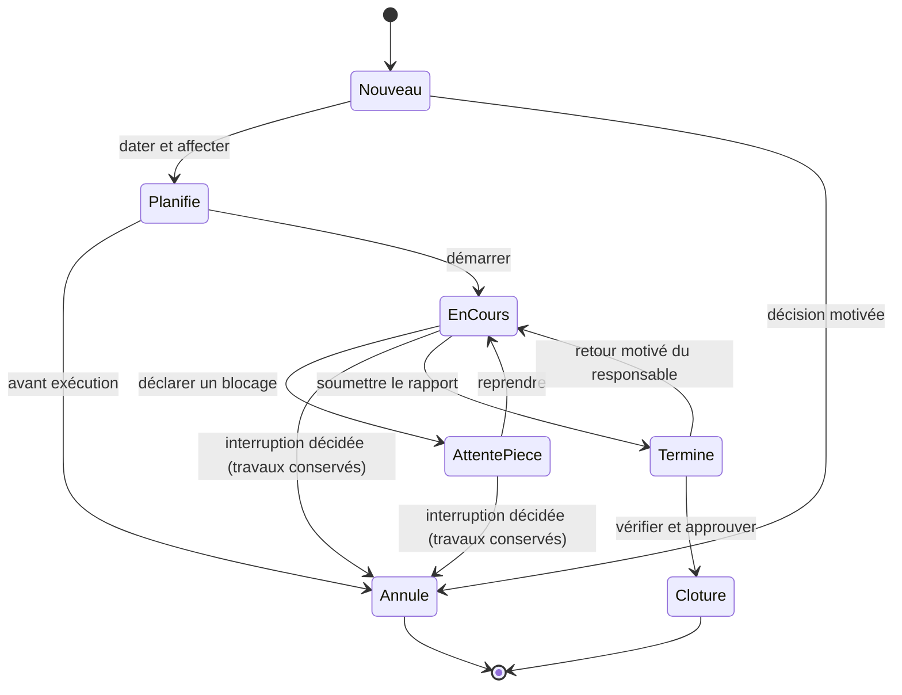
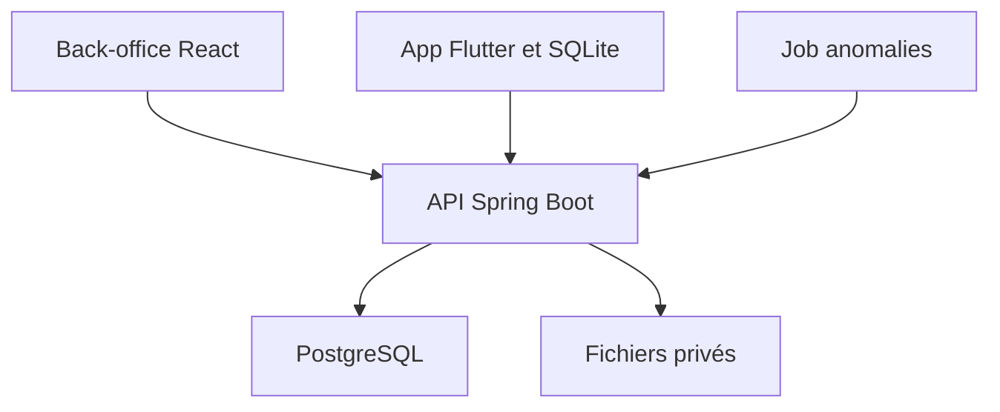

# Planning complet du projet GMAO pour PME industrielles

**Sujet :** système de gestion de maintenance assistée par ordinateur, avec application mobile hors ligne pour les techniciens.  
**Cadre :** PFA 5IIR, option DDSI, EMSI Rabat, année universitaire 2026–2027.  
**Encadrant indiqué dans le support :** Pr. El Mehdi El Graoui.  
**Version du planning :** 2.0, 14 novembre 2026 (organisation en sprints, voir la revue ci-dessous).  
**Source des exigences :** présentation fournie « PFA – GMAO PME industrielles.pptx », 15 diapositives.  
**Règles de contribution :** [AGENTS.md](../AGENTS.md) fait foi pour le travail des développeurs et des agents IA.  
**Statut :** proposition détaillée à valider avec l'encadrant. Les choix techniques, estimations et règles proposées ci-dessous ne sont pas des exigences déjà approuvées.

### Revue du planning (version 2.0)

| Constat sur la version initiale | Correction apportée | Section |
|---|---|---|
| Planning organisé par semaines, sans sprints, objectifs ni portes d'acceptation | 7 sprints de 2 semaines, objectif et porte par sprint, cérémonies, règles de report et de réserve | 14 |
| Capacité exprimée en heures brutes, sans tenir compte des cérémonies et des revues | Production nette estimée (environ 520 h) et recalage de l'estimation ascendante à la porte G1 | 14.1, 14 (G1) |
| Les épisodes de panne, la synchronisation serveur et les exigences non fonctionnelles existaient dans le modèle et l'API mais pas dans le backlog | Nouvelles familles PAN, SYN et NFR, plus SOC-06 et SOC-07 | 5 |
| Recette R01–R23 sans lien explicite avec les exigences | Colonnes « Exigences » et « Porte », scénarios R24 à R41 pour les exigences non couvertes | 15 |
| Aucun moyen d'abandonner un OT déjà démarré dans le diagramme d'états | Transition d'interruption décidée par le responsable, travaux conservés | 6 |
| Décisions ouvertes dispersées dans le texte | Registre de décisions ouvertes D-01 à D-10 à trancher avant la porte G1 | 3 |
| « Prototype » de synchronisation, incompatible avec une dette zéro | Première tranche du code livrable, fusionnée avec ses tests | 14.2 |
| Pas de règles de qualité, de revue ni d'usage d'agents IA | AGENTS.md, portes qualité, contrôle automatique des conventions, modèles de PR et de ticket | 15, 16 |
| Risques de dérive du CDC, de dette et de revue non couverts | Nouveaux risques et mesures | 17 |

## 1. Hypothèses, objectif et résultat attendu

Le produit doit permettre à une PME de connaître ses équipements, organiser sa maintenance corrective et préventive, suivre ses pièces, conserver les rapports des techniciens et calculer des indicateurs fiables. Un technicien doit pouvoir réaliser une intervention dans une zone sans réseau, fermer puis rouvrir son application, et transmettre ses données lorsqu'une connexion redevient disponible.

| Hypothèse de planification | Valeur retenue |
|---|---|
| Durée | 14 semaines, conformément au support |
| Équipe | 2 développeurs, hypothèse de dimensionnement |
| Capacité | 30 h par personne et par semaine, à confirmer selon les cours |
| Travail engagé | 24 h par personne et par semaine |
| Réserve | 6 h par personne et par semaine pour imprévus, retours et difficultés |
| Charge planifiée | 14 × 2 × 24 = **672 heures-personnes** |
| Capacité totale | 840 heures-personnes, dont **168 h de réserve** |
| Répartition | 336 h planifiées par développeur, soit 50/50 en charge estimée |
| Déploiement initial | Une PME, plusieurs sites possibles, un magasin par site |
| Mobile livré | Android en priorité, avec Flutter |
| Langue et monnaie | Interface française, coûts en MAD |
| Dates | S1 à S14 ; les dates réelles seront fixées sur le calendrier officiel |
| Cadence | 7 sprints de 2 semaines, une porte à la fin de chacun (section 14) |
| Qualité | Dette technique zéro, 100 % de conformité au CDC, PR relue par l'autre développeur |
| Agents IA | Autorisés sous les règles d'AGENTS.md ; le développeur auteur reste responsable de chaque ligne et la revue humaine n'est jamais réduite |

Ce volume correspond à un PFA soutenu avec un périmètre maîtrisé. Les tests et la documentation font partie des 24 h engagées, ils ne sont pas reportés sur la réserve. Si la disponibilité réelle n'est que de 20 h par personne et par semaine, la même charge de 672 h représente environ 21 semaines avec 20 % de réserve. Pour une personne à 30 h par semaine, compter environ 28 semaines avec la même réserve, avant adaptation des dépendances.

### Scénario de réussite

1. Un opérateur signale une panne sur une machine.
2. Le responsable valide la demande, crée un OT et l'affecte.
3. Le technicien synchronise ses tâches avant d'entrer dans l'atelier.
4. En mode avion, il scanne le QR code, consulte la fiche locale, réalise sa checklist, saisit son diagnostic, ses temps, les pièces utilisées et des photos.
5. Il ferme puis relance l'application : son travail est toujours présent.
6. Il retrouve le réseau et synchronise. Les nouvelles tentatives n'engendrent aucun doublon.
7. Le magasinier traite les consommations. Le responsable vérifie et clôture l'OT.
8. L'historique, les coûts et les indicateurs reflètent les données validées. Une anomalie simulée apparaît dans le tableau de bord.

## 2. Périmètre et correspondance avec le support

### Version complète attendue en S12

| Exigence du support | Réponse prévue | Preuve attendue |
|---|---|---|
| Équipements | Sites, lignes, machines, documents, QR, historique | Création d'une machine et consultation par QR |
| Interventions | DI, validation, OT, affectation, statuts, rapport, clôture | Parcours correctif complet |
| Préventif | Plans calendrier et compteur, checklist, génération automatique | Une échéance génère un seul OT |
| Stock | Articles, mouvements, consommations, seuils, demandes d'achat | Consommation, rupture et réapprovisionnement |
| Mobile | SQLite, lecture et écriture hors ligne, photos, synchronisation | Démonstration en mode avion et après redémarrage |
| Pilotage | MTBF, MTTR, disponibilités, coûts, exports et rapport imprimable | Comparaison avec un jeu de calcul connu |
| IA | Option A : détection d'anomalies dans les historiques | Score, facteurs observés, évaluation et limites |
| Qualité | Git, revues, tests, Docker et CI | Reconstruction depuis un dépôt propre |
| Livrables académiques | Existant, CDC, UML, MCD, BPMN, rapport et soutenance | Dossier final versionné |

### Ordre des versions

| Version | Porte et échéance | Contenu et utilité |
|---|---|---|
| CDC validé | G1, fin S2 | Périmètre, règles, critères de recette et backlog estimé |
| Preuve hors ligne | G2, fin S4 | Un OT local, rapport hors ligne, redémarrage, synchronisation sans doublon ; première tranche du code livrable |
| Parcours correctif | G3, fin S6 | Demande, OT, affectation, tâche mobile, rapport local synchronisé, premier OT préventif |
| Démo web | G4, fin S8 | Utilisateurs, équipements, DI/OT, préventif calendrier et compteur, stock et achats |
| Démo hors ligne complète | G5, fin S10 | Scan, checklist, temps, pièces déclarées, photos, conflits et reprise |
| Version fonctionnelle complète | G6, fin S12 | Six modules, IA, indicateurs vérifiés, recette, gel fonctionnel |
| Version de soutenance | G7, fin S14 | Version stabilisée, documentation, déploiement et démonstration préparée |

L'ordre détaillé avance une première tranche de synchronisation vers S3–S4 et commence le stock et le préventif avant S11. Il conserve les échéances principales du support tout en évitant de découvrir les difficultés trop tard. La démo web, située à S7 dans la version initiale, est portée à S8 pour coïncider avec une fin de sprint.

### Extensions après le PFA

Notifications FCM, Metabase, iOS, fournisseurs et bons de commande complets, facturation, gestion de plusieurs entreprises clientes, IoT en temps réel et prédiction probabiliste de panne sont des extensions. Le support propose notamment FCM et Metabase dans sa stack ; leur utilité sera réévaluée après la couverture des exigences fonctionnelles. Le module de détection d'anomalies, lui, fait partie de la version complète.

## 3. Étude de terrain et cahier des charges

### Travail des semaines 1 et 2

**Entretiens :** rencontrer si possible un responsable maintenance, un technicien et un magasinier. Faire confirmer le parcours par un opérateur ou un responsable de production. Si aucune PME n'est accessible, documenter explicitement une entreprise fictive et les hypothèses du scénario.

Questions à poser :

- Comment une panne est-elle signalée, priorisée puis affectée aujourd'hui ?
- Quels équipements et quelles pièces causent le plus d'arrêts ?
- Qui peut déclarer qu'une machine est à nouveau disponible ?
- Quelle différence faites-vous entre durée d'arrêt, durée de réparation et temps passé par un technicien ?
- Combien de temps un technicien peut-il rester sans réseau ? Quel téléphone utilise-t-il ?
- Quelles informations doivent être téléchargées avant son départ ?
- Les pièces sont-elles distribuées par le magasinier ou prises directement ?
- Quel calendrier de fonctionnement et quelles périodes d'arrêt planifié faut-il utiliser ?
- Qui valide une consommation, un rapport et une clôture ?
- Quels historiques, fichiers Excel ou fiches papier peuvent être anonymisés ?
- Quelle langue d'interface les techniciens attendent-ils : français, arabe, les deux ?
- Quelles règles de protection des données personnelles s'appliquent aux informations que vous accepteriez de partager ?

**Étude de l'existant :** comparer Odoo Maintenance et openMAINT à partir de leur documentation officielle, puis compléter par une prise en main si une démo est accessible. Ajouter une troisième solution seulement si elle apporte un angle utile.

| Solution | Points à observer | Production attendue |
|---|---|---|
| Odoo Maintenance | Équipement, demande corrective/préventive, étapes de traitement, calendrier | Une fiche synthèse avec sources et captures si autorisées |
| openMAINT | Plans, checklists, ordres de travail, maintenance corrective, liens avec pièces | Une fiche synthèse avec sources et captures si autorisées |
| Système actuel de la PME | Papier, Excel, responsabilités, délais et informations manquantes | BPMN de l'existant et problèmes observés |

Ce tableau constitue une grille d'étude, pas un audit déjà réalisé. Ne pas conclure sur les fonctions hors ligne ou les licences à partir d'une simple page marketing.

**Contenu du CDC :** problème, acteurs, périmètre, cas d'utilisation, règles métier, besoins hors ligne, exigences de sécurité, indicateurs et leurs définitions, hypothèses de volumétrie, critères de recette, exclusions, planning et risques.

**Jalon S2 (porte G1) :** CDC relu par l'équipe et validé avec l'encadrant ; décisions métier ambiguës tranchées ou planifiées ; backlog estimé en heures.

### Gouvernance du CDC

Dès sa validation, le CDC est versionné par une étiquette Git (`cdc-v1.0`) et devient la seule référence des exigences. Avant cela, le backlog (section 5) et les règles (section 6) de ce document tiennent lieu de base provisoire.

- Toute exigence porte un identifiant stable (`SOC-`, `EQ-`, `INT-`, `PAN-`, `PRE-`, `STK-`, `SYN-`, `MOB-`, `PIL-`, `IA-`, `NFR-`). Code, tests, PR et documents y renvoient.
- Aucune fonction hors CDC n'est développée et aucune exigence du CDC n'est omise : la conformité est vérifiée à la revue de chaque PR et à chaque porte.
- Une ambiguïté ouvre un ticket `cdc-question`. Un changement ouvre un ticket `cdc-change` avec son impact sur le périmètre, les heures, les données, les tests et la documentation ; il est approuvé par les deux développeurs, et par l'encadrant s'il modifie le périmètre. La décision est consignée dans `docs/decisions.md` et le CDC est versionné avant que le code ne s'y appuie.
- Le procès-verbal de recette (porte G6) montre, pour chaque identifiant, le code, le test et le résultat.

### Décisions ouvertes à trancher

Ces points étaient implicites ou dispersés dans le texte. Chacun reçoit une décision enregistrée (ADR) avant son échéance ; la proposition est la valeur retenue par défaut tant qu'aucune décision n'est prise.

| ID | Décision | Proposition par défaut | Échéance |
|---|---|---|---|
| D-01 | Sortie d'un OT démarré qui ne sera pas terminé | Transition `EnCours` ou `AttentePiece` vers `Annule`, réservée au responsable, avec motif ; temps, travaux et consommations conservés (section 6) | G1 |
| D-02 | Qui valide le début d'un épisode de panne | Le responsable, à l'acceptation de la DI ; heure déclarée par l'opérateur, modifiable avec motif audité | G1 |
| D-03 | Échéance préventive alors qu'un OT du plan est déjà ouvert | Rattacher l'échéance à l'OT ouvert (section 6) | G1 |
| D-04 | Chiffrement de la base locale | Stockage privé de l'application par défaut ; chiffrement seulement si la PME l'exige, solution validée au sprint 2 | G2 |
| D-05 | Fenêtre hors ligne et rétention du journal de synchronisation | 7 jours hors ligne, 90 jours de journal | G1 |
| D-06 | Politique de l'établissement sur l'usage d'outils d'IA générative et sur leur déclaration dans le rapport | À demander à l'encadrant ; la déclaration éventuelle est rédigée par les développeurs | G1 |
| D-07 | Licence du code et visibilité du dépôt | À choisir avant d'ajouter des dépendances dont la licence pourrait contraindre ce choix | G1 |
| D-08 | Langue de l'interface | Français ; l'arabe n'est ajouté que si le terrain l'exige, par changement de périmètre | G1 |
| D-09 | Données personnelles | Données fictives pour le PFA ; si des données réelles sont utilisées, vérifier les obligations légales applicables, notamment la loi marocaine 09-08 et la CNDP | G1 |
| D-10 | Limites des photos et des documents (1 600 px, 5 Mo, 5 par rapport) | Valeurs de la section 9.8 | G1 |

## 4. Acteurs et droits

| Fonction | Administrateur | Responsable maintenance | Technicien | Opérateur | Magasinier | Direction |
|---|---|---|---|---|---|---|
| Gérer comptes, rôles et sites | Oui | Non | Non | Non | Non | Non |
| Gérer fiches équipements | Configuration | Oui | Lecture autorisée | Lecture minimale | Lecture | Lecture |
| Créer une DI | Selon rôle cumulé | Oui | Oui | Oui | Selon rôle cumulé | Non |
| Valider/rejeter une DI | Selon rôle cumulé | Oui | Non | Non | Non | Non |
| Planifier et affecter un OT | Selon rôle cumulé | Oui | Non | Non | Non | Non |
| Saisir rapport et exécution | Selon rôle cumulé | Révision contrôlée | OT affectés | Non | Non | Non |
| Valider mouvements de stock | Selon rôle cumulé | Lecture/arbitrage | Déclarer utilisation | Non | Oui | Lecture |
| Clôturer un OT | Selon rôle cumulé | Oui | Non | Non | Non | Non |
| Consulter indicateurs et coûts | Selon rôle cumulé | Oui | Historique autorisé | Non | Vue stock | Oui |

Le rôle administrateur technique n'accorde pas automatiquement les droits métier. Pour une petite équipe, un utilisateur peut cumuler des rôles explicitement attribués. Toutes les autorisations sont contrôlées dans l'API, y compris sur les téléchargements et les endpoints de synchronisation. Les droits sont aussi limités aux sites autorisés.

## 5. Backlog fonctionnel et critères d'acceptation

**P0 :** nécessaire pour sécuriser le parcours métier ou les données. **P1 :** exigence de la version complète à terminer avant S12. **P2 :** extension après stabilisation. P1 ne signifie pas facultatif pour la soutenance. Chaque identifiant est livré dans le sprint indiqué en section 14.4 et couvert par un scénario de recette ou un test automatisé (section 15). Une fonction absente de cette liste n'est pas développée sans changement du CDC.

### A. Socle et administration

| ID | Priorité | Travail | Critère d'acceptation |
|---|---|---|---|
| SOC-01 | P0 | Connexion, renouvellement, déconnexion et révocation | Un compte désactivé ne peut plus synchroniser |
| SOC-02 | P0 | Rôles et périmètre de sites | Un technicien ne peut accéder à l'OT d'un autre site |
| SOC-03 | P0 | Sites, lignes, utilisateurs et affectations | Une machine appartient à une ligne de son site |
| SOC-04 | P0 | Migrations, validations et erreurs structurées | Une installation vide démarre par migrations |
| SOC-05 | P0 | Audit métier | Une affectation, clôture ou correction de stock garde auteur et date |
| SOC-06 | P1 | Appareils enregistrés : liste et révocation par l'administrateur | Un appareil révoqué ne peut plus synchroniser et ses brouillons locaux sont conservés jusqu'à une reconnexion contrôlée |
| SOC-07 | P0 | Création de compte, mot de passe temporaire et réinitialisation par l'administrateur | Le mot de passe temporaire doit être changé à la première connexion et n'apparaît jamais dans les journaux |

### B. Équipements

| ID | Priorité | Travail | Critère d'acceptation |
|---|---|---|---|
| EQ-01 | P0 | Fiche machine : code, nom, modèle, série, criticité, état et emplacement | Code métier unique et champs obligatoires validés |
| EQ-02 | P0 | Arborescence site → ligne → équipement | Filtre site/ligne cohérent sur web et mobile |
| EQ-03 | P0 | QR code contenant un identifiant stable, imprimable depuis le web | Un QR d'une machine téléchargée ouvre sa fiche hors ligne |
| EQ-04 | P1 | Documents, photos et historique | Un document choisi pour le hors ligne reste consultable après redémarrage |
| EQ-05 | P0 | Archivage | Une machine avec historique est archivée sans supprimer ses interventions |

### C. Demandes et interventions

| ID | Priorité | Travail | Critère d'acceptation |
|---|---|---|---|
| INT-01 | P0 | DI : équipement, symptôme, gravité, arrêt éventuel et photo | L'opérateur retrouve ses demandes et leur décision |
| INT-02 | P0 | Acceptation/rejet motivé | La décision conserve responsable et motif |
| INT-03 | P0 | OT correctif/préventif, priorité et échéance | Un OT préventif peut exister sans DI |
| INT-04 | P0 | Planification et affectation | Le technicien reçoit l'OT à sa prochaine synchronisation |
| INT-05 | P0 | Transitions d'états autorisées | Une transition interdite est refusée côté serveur |
| INT-06 | P0 | Checklist, diagnostic, actions et temps ; les pièces utilisées (STK-03, STK-04) et les photos (MOB-04, SYN-06) se rattachent au même rapport | Le rapport reste modifiable localement avant envoi |
| INT-07 | P0 | Vérification et clôture | Clôture impossible tant qu'un problème bloquant de stock ou rapport subsiste |
| INT-08 | P1 | Réouverture contrôlée | Le responsable renvoie un OT terminé en cours avec motif audité |

### D. Préventif

| ID | Priorité | Travail | Critère d'acceptation |
|---|---|---|---|
| PRE-01 | P1 | Plan calendrier avec fréquence, date d'ancrage et checklist | Une échéance produit un OT et conserve sa référence de plan |
| PRE-02 | P1 | Compteur cumulatif et relevés manuels | Un relevé inférieur au précédent est signalé, pas accepté silencieusement |
| PRE-03 | P1 | Plan par compteur et seuil | Franchir un seuil déclenche un OT sans doublon |
| PRE-04 | P0 | Génération idempotente, reprise après interruption | Deux exécutions du job ne créent qu'une occurrence |
| PRE-05 | P1 | Vue des échéances et retards | Une règle désactivée cesse de produire de nouveaux OT |

### E. Stock

| ID | Priorité | Travail | Critère d'acceptation |
|---|---|---|---|
| STK-01 | P1 | Pièce, unité, référence, prix et seuil | Les quantités et les unités incompatibles sont refusées |
| STK-02 | P0 | Entrée, sortie, retour et ajustement motivé | Chaque mouvement a un auteur et une référence |
| STK-03 | P0 | Consommation liée à un OT | Une répétition réseau ne retire pas deux fois la quantité |
| STK-04 | P0 | Gestion des consommations hors ligne | Une pénurie conserve la déclaration et crée un cas à arbitrer |
| STK-05 | P1 | Alerte seuil et demande d'achat | La demande passe par brouillon, soumise, approuvée/rejetée puis traitée |
| STK-06 | P0 | Annulation/correction par contre-mouvement | Un mouvement validé n'est pas effacé de l'historique |

### F. Application technicien

| ID | Priorité | Travail | Critère d'acceptation |
|---|---|---|---|
| MOB-01 | P0 | Téléchargement de la tournée | Les OT affectés, équipements et checklists sont présents localement |
| MOB-02 | P0 | Scan QR et recherche par code | Un code inconnu hors ligne affiche « équipement non téléchargé » |
| MOB-03 | P0 | Écritures SQLite et file durable | Aucune saisie validée localement n'est perdue lors d'un redémarrage normal |
| MOB-04 | P0 | Rapport, temps, checklist et photos hors ligne | Le parcours se termine sans appel réseau obligatoire |
| MOB-05 | P0 | Synchronisation et reprises | Timeout après validation serveur : aucun doublon après reprise |
| MOB-06 | P0 | État des envois et écran de conflits | L'utilisateur distingue local, en attente, synchronisé et à résoudre |
| MOB-07 | P0 | Isolement des comptes | Le compte B ne voit jamais le cache et les brouillons du compte A |

### G. Pilotage et analyse

| ID | Priorité | Travail | Critère d'acceptation |
|---|---|---|---|
| PIL-01 | P1 | MTBF, MTTR et disponibilités | Les résultats correspondent au jeu de référence décrit en section 10 |
| PIL-02 | P1 | Coûts par équipement et période | Les coûts historiques restent stables si un tarif courant change |
| PIL-03 | P1 | OT en retard, taux de préventif et seuils stock | Chaque carte affiche sa période et son périmètre |
| PIL-04 | P1 | CSV et rapport imprimable en PDF depuis le navigateur | L'export respecte les filtres et droits de la vue |
| IA-01 | P1 | Générateur de données synthétiques et extraction de variables | Deux générations avec la même graine sont reproductibles |
| IA-02 | P1 | Détection d'anomalies, comparaison et affichage | Une anomalie injectée ressort, avec score et limites explicites ; un score ancien est marqué comme tel et un échec du job n'affecte pas le fonctionnement métier |

### H. Pannes et temps de production

| ID | Priorité | Travail | Critère d'acceptation |
|---|---|---|---|
| PAN-01 | P0 | Épisode de panne : début validé, lié à la DI et aux OT | Plusieurs OT rattachés au même épisode comptent une seule panne |
| PAN-02 | P0 | Remise en service enregistrée séparément de la clôture de l'OT | La remise en service arrête l'arrêt machine ; la clôture de l'OT plus tard ne modifie pas les durées |
| PAN-03 | P1 | Fenêtres de production et arrêts planifiés par site ou équipement | Sans calendrier, les indicateurs affichent « données insuffisantes » |
| PAN-04 | P1 | Sessions de réparation active et intervalles d'arrêt | Deux techniciens simultanés ne doublent pas la durée de réparation de la machine, les arrêts qui se chevauchent sont dédupliqués |

### I. Synchronisation côté serveur

| ID | Priorité | Travail | Critère d'acceptation |
|---|---|---|---|
| SYN-01 | P0 | Enregistrement de l'appareil et premier chargement cohérent avec curseur initial | Seules les données autorisées sont renvoyées ; un dépassement de limite est annoncé et jamais tronqué silencieusement |
| SYN-02 | P0 | Réception idempotente des commandes avec résultat par commande | Même identifiant et même contenu : même résultat ; contenu différent : erreur explicite |
| SYN-03 | P0 | Journal de changements, curseur et pagination | Aucun changement validé n'est sauté, même avec des transactions concurrentes |
| SYN-04 | P0 | Retraits d'accès et purge ciblée (réaffectation, archivage, révocation) | La projection est retirée de l'appareil concerné et le brouillon est isolé pour arbitrage |
| SYN-05 | P1 | Resynchronisation contrôlée d'un client trop ancien | Les brouillons sont conservés et rien n'est renvoyé en masse sous de nouveaux identifiants |
| SYN-06 | P0 | Pièces jointes : envoi idempotent, contrôle du type, de la taille et de l'empreinte, accès autorisé | Un envoi répété ne produit qu'une seule pièce jointe |

### J. Exigences non fonctionnelles

| ID | Priorité | Travail | Critère d'acceptation |
|---|---|---|---|
| NFR-SEC-01 | P0 | Contrôle d'accès objet par objet sur chaque ressource, fichier et endpoint de synchronisation | Un test par ressource prouve le refus hors périmètre |
| NFR-SEC-02 | P0 | Authentification : hachage adapté, JWT validés, renouvellement révocable, limitation des tentatives, journaux sans secret | Une série d'échecs est limitée ; aucun jeton ni mot de passe dans les journaux |
| NFR-SEC-03 | P0 | Secrets hors du dépôt, analyse des secrets et des dépendances en CI | Un secret ou une dépendance vulnérable fait échouer la CI |
| NFR-PERF-01 | P1 | Objectifs de performance de la section 15 mesurés | Les mesures sont consignées avec matériel et conditions, écart traité |
| NFR-OPS-01 | P0 | Déploiement reproductible par Docker Compose | Une installation depuis un dépôt propre démarre avec migrations et données de démonstration |
| NFR-OPS-02 | P0 | Sauvegarde et restauration de la base et des fichiers | Objectifs proposés : perte maximale de 24 h, reprise en moins de 4 h, à confirmer ; restauration prouvée |
| NFR-UX-01 | P1 | États vide, chargement, hors ligne et erreur ; couleur toujours doublée d'un texte ou d'une icône ; actions fréquentes à une main | Chaque écran critique expose ces états |
| NFR-DATA-01 | P0 | Données de démonstration fictives ou anonymisées, marquées comme telles | Aucune donnée personnelle réelle dans le dépôt ni dans les jeux de démonstration |
| NFR-QUAL-01 | P0 | Git, revues, tests, Docker et CI conformes à AGENTS.md | Reconstruction depuis un dépôt propre, CI verte, aucune dette connue fusionnée |

## 6. Règles métier et processus

### DI et OT

Une DI passe de **Soumise** à **Acceptée** ou **Rejetée**. Une DI acceptée peut être liée à un ou plusieurs OT pour une panne complexe. La panne est comptabilisée une seule fois, grâce à un épisode de défaillance distinct des OT.



« Affecté » est un attribut et un événement, pas un état supplémentaire. Un OT est planifié lorsque l'affectation et la date sont définies. L'annulation est autorisée avant la première exécution. Après démarrage, l'abandon d'un OT passe par une transition d'interruption réservée au responsable, avec motif obligatoire : les travaux, temps et consommations déjà saisis sont conservés et leurs coûts restent comptés, la décision est tracée plutôt qu'une suppression (proposition D-01, à valider au CDC).

Règles à appliquer côté serveur :

- Le technicien démarre et renseigne ses OT affectés. Le responsable conserve la décision de clôture.
- La remise en service d'une machine est un événement distinct de la clôture administrative de l'OT.
- Une machine peut avoir plusieurs OT sans créer plusieurs pannes pour le même arrêt.
- Un rapport contient les champs nécessaires à son type d'intervention. Les temps ne peuvent être négatifs ni se chevaucher pour un même technicien.
- Le temps humain, le temps de réparation de la machine et le temps d'arrêt restent trois notions séparées.
- Les corrections après clôture sont motivées, versionnées et auditées. Elles entraînent un recalcul traçable des agrégats.
- Priorité critique ne signifie pas automatiquement arrêt de production. Ce fait doit être déclaré séparément.

### Préventif

Pour le PFA, proposer des intervalles simples en jours et des compteurs cumulatifs d'heures ou de cycles. La règle calendrier reste ancrée à ses échéances prévues. Une occurrence a une clé unique `(plan_id, due_date)` ou `(plan_id, threshold_value)`.

Si une même règle accumule plusieurs échéances manquées, créer un OT de rattrapage listant les occurrences concernées et consigner celles couvertes. Si un OT du plan est déjà ouvert, rattacher l'échéance à cet OT suivant la règle validée au CDC. Un saut de compteur de 950 à 1 250 sur un intervalle de 100 doit être traité explicitement, pas créer une quantité incontrôlée d'OT.

Le compteur peut être relevé hors ligne. Les relevés sont conservés individuellement avec leur date observée et leur réception serveur. Une valeur rétrograde, une remise à zéro ou un remplacement de compteur demande une correction autorisée. Le job ne déclenche pas une échéance sur un relevé rejeté.

### Stock et coûts

Le solde validé est calculé à partir de mouvements traçables, éventuellement avec un solde matérialisé mis à jour dans la même transaction. Les contrôles de disponibilité utilisent un verrou ou une mise à jour conditionnelle pour éviter deux sorties concurrentes sur le même stock.

Le technicien peut déclarer une utilisation hors ligne mais ne peut garantir la disponibilité globale depuis son téléphone. Une déclaration crée une consommation **à valider**. Le magasinier la valide en ligne si le stock le permet ; sinon elle passe en **à arbitrer**. Le rapport est conservé, le stock validé reste inchangé, et un écart potentiel est visible. La régularisation se fait par réception, correction justifiée ou modification de la déclaration. La clôture attend la résolution. Cela couvre explicitement la limite d'une saisie physique faite sans connexion.

Pour le PFA, retenir un prix unitaire de référence copié dans chaque mouvement validé. Ce choix est plus simple qu'une valorisation FIFO ou comptable complète. Le taux horaire est également copié dans les lignes de temps validées. Les retours et corrections ont leur effet signé sur le coût.

## 7. Architecture technique proposée

Le choix Spring Boot permet de travailler les transactions, les API, la sécurité et les règles métier utiles à un parcours d'ingénieur backend. Flutter et PostgreSQL correspondent aux propositions du support. Un monolithe structuré par domaine suffit au périmètre initial.

| Composant | Choix | Rôle |
|---|---|---|
| API | Java 21, Spring Boot, Maven | Règles métier, transactions, sync et tâches planifiées |
| Sécurité | Spring Security, JWT signés, sessions de renouvellement révocables | Authentification et autorisation |
| Persistance serveur | PostgreSQL, JPA/Hibernate, migrations Flyway | Données métier et contraintes |
| Web | React + TypeScript + Vite | Back-office et tableaux de bord |
| Mobile | Flutter + SQLite via sqflite | Application Android et persistance locale |
| État mobile | ViewModels/ChangeNotifier et repositories | Écrans découplés des sources locales et distantes |
| Photos/documents | Volume privé persistant, accès par API autorisée | Fichiers hors de la base relationnelle |
| IA | Python, pandas et scikit-learn dans un job batch | Détection d'anomalies sur historique agrégé |
| API contractuelle | OpenAPI | Contrat partagé entre web, mobile et backend |
| Exécution | Docker Compose | Web/reverse proxy, API et PostgreSQL |
| Livraison | GitHub Actions | Vérifications, builds et image déployable |

Choisir en S3 une version stable maintenue de Spring Boot compatible avec Java 21 et la documentation utilisée. Geler Maven, Node, Flutter et les dépendances dans les fichiers de version et lockfiles. Ne pas reprendre une version de tutoriel sans vérifier sa maintenance.



Les flux du job IA utilisent une identité technique limitée : lecture des variables agrégées et publication des scores. Le job est lancé manuellement pour la démo et par planification quotidienne pour le pilote. Le cœur métier continue de fonctionner si ce job échoue.

### Organisation du code

Un dépôt commun contient `backend/`, `backoffice/`, `mobile/`, `analytics/`, `docs/` et `infra/`. Le backend est organisé par modules `identity`, `assets`, `workorders`, `preventive`, `inventory`, `sync` et `reporting`. Dans chaque module, conserver contrôleurs, services et accès aux données nécessaires, sans imposer une couche abstraite supplémentaire à chaque classe.

Prévoir les fichiers `README.md`, `docs/cdc.md`, `docs/data-dictionary.md`, `docs/sync-protocol.md`, `docs/decisions.md`, `docs/test-plan.md` et `docs/deployment.md`. Les diagrammes peuvent être conservés en Mermaid ou PlantUML pour rester modifiables.

### Données et volumétrie cible

Hypothèse de pilote : 2 sites, 10 lignes, 100 machines, 10 techniciens, 200 références de pièces et environ 1 000 interventions historiques. Le mobile conserve les tâches ouvertes affectées et un historique récent configuré, par exemple 90 jours, pour les équipements autorisés. Les documents volumineux sont téléchargés à la demande ou explicitement marqués pour le hors ligne.

Ces nombres servent aux tests et au jeu de démonstration. Ils ne constituent pas une promesse de capacité industrielle.

## 8. Modèle de données à concevoir

### Tables métier

| Groupe | Entités | Champs ou contraintes essentiels |
|---|---|---|
| Identité | `users`, `roles`, `user_roles`, `user_sites`, `refresh_sessions` | Compte actif, mot de passe haché, périmètre, session révocable |
| Structure | `sites`, `production_lines`, `equipment` | Code unique par PME, site, ligne, criticité, état, archivage |
| Documents | `attachments` | UUID, propriétaire métier, chemin privé, taille, MIME, empreinte, état d'envoi |
| Signalement | `intervention_requests` | Équipement, symptôme, auteur, décision, motif, dates |
| Pannes | `failure_episodes`, `downtime_intervals`, `operating_windows`, `repair_sessions` | Début de panne, remise en service, fenêtre de production, réparation active |
| Intervention | `work_orders`, `work_order_status_history` | DI facultative, épisode facultatif, type, priorité, affectation, dates, version |
| Exécution | `work_reports`, `time_entries`, `checklist_results` | Diagnostic, actions, auteur, durée humaine, taux copié, version |
| Préventif | `preventive_plans`, `checklist_items`, `preventive_occurrences` | Équipement, calendrier/compteur, intervalle, occurrence unique, OT lié |
| Compteurs | `equipment_counters`, `counter_readings` | Unité, valeur cumulative, date observée, validation |
| Stock | `parts`, `stock_balances`, `stock_movements`, `part_consumptions` | Magasin, quantité décimale, prix copié, OT, état de validation |
| Achats | `purchase_requests`, `purchase_request_items` | Pièce, quantité, motif, décision, lien de réception |
| Analyse | `anomaly_runs`, `anomaly_scores` | Date des données, modèle, score, seuil, version, contexte |
| Traçabilité | `audit_events` | Auteur, action, ressource, date serveur, résumé du changement |

Les comptes peuvent être limités à une seule PME par déploiement. Ne pas ajouter un modèle multi-entreprise incomplet : si le produit évolue vers un SaaS partagé, l'isolation interentreprises devient une évolution explicite de conception et de tests.

### Tables de synchronisation

| Serveur | Fonction |
|---|---|
| `registered_devices` | Relier un appareil à un compte et pouvoir le révoquer |
| `processed_operations` | Mémoriser l'identifiant, l'empreinte du contenu et le résultat d'une opération reçue |
| `sync_changes` | Journal durable des mises à jour, suppressions logiques et retraits d'accès |
| `sync_clock` | Produire un ordre de changement compatible avec les commits |

| SQLite | Fonction |
|---|---|
| Tables métier locales | Copie autorisée des OT, équipements, checklists, pièces et documents sélectionnés |
| `local_drafts` | Saisie de l'utilisateur distincte de la copie serveur |
| `pending_operations` | File durable : UUID, dépendances, commande, version attendue, statut et tentatives |
| `pending_attachments` | Chemin privé de photo, empreinte, parent et état d'envoi |
| `sync_state` | Curseur appliqué, compte/appareil et version du schéma |
| `sync_conflicts` | Copie locale, version serveur et résolution choisie |

### Contraintes communes

- Utiliser des UUID pour les ressources créables depuis le mobile, notamment rapports, temps, relevés et pièces déclarées.
- Utiliser `version` pour les entités éditables et `created_at`, `updated_at` côté serveur. Conserver séparément `observed_at` pour la date métier issue du téléphone.
- Stocker les dates serveur en UTC et afficher le fuseau du site, initialement `Africa/Casablanca`. Ne pas coder un décalage fixe.
- Utiliser `NUMERIC` et `BigDecimal` pour quantités et coûts, avec règles d'arrondi définies. Conserver MAD comme devise du pilote.
- Définir les clés étrangères et unicités en base, notamment celles des occurrences préventives et des opérations idempotentes.
- Archiver les référentiels utilisés. Conserver les tombstones nécessaires à la suppression des copies mobiles.
- Indexer les accès réellement utilisés : OT par technicien/état, équipement par site/code, épisodes par équipement/date et journal de sync par révision.

### Diagrammes à livrer

Diagramme de cas d'utilisation par acteur, BPMN de l'existant et du parcours cible, diagramme d'états des OT, MCD/MLD, diagramme de classes métier, diagramme de composants/déploiement, séquence de synchronisation normale et séquence avec conflit. Le diagramme de classes doit représenter les concepts métier, pas recopier tous les getters des entités JPA.

## 9. Conception détaillée du mode hors ligne

### 9.1 Ce qui fonctionne sans réseau

| Action | Hors ligne | Condition |
|---|---|---|
| Ouvrir l'application et ses tâches | Oui | Première connexion en ligne et cache préparé |
| Consulter fiche, checklist et historique récent | Oui | Données téléchargées et encore autorisées au dernier contact |
| Lire une notice | Oui | Document explicitement téléchargé |
| Scanner un QR | Oui | Machine disponible localement |
| Démarrer, renseigner et terminer localement un OT | Oui | OT affecté en cache ; validation serveur à la synchronisation |
| Saisir temps, relevés et pièces utilisées | Oui | Déclarations en attente, pas de garantie sur le stock global |
| Prendre une photo | Oui | Espace disponible et permission accordée |
| Créer un compte, charger un OT inconnu, affecter ou clôturer | Non | Opération serveur réservée aux acteurs autorisés |

L'interface affiche la dernière synchronisation, le nombre d'envois en attente et les erreurs à résoudre. « Terminé localement » ne doit jamais être affiché comme « accepté et clôturé par le serveur ».

### 9.2 Écriture durable sur le téléphone

Chaque action sauvegardée réalise **dans une seule transaction SQLite** la modification du brouillon ou de la projection locale et l'insertion de la commande correspondante dans `pending_operations`. L'écran confirme la sauvegarde après le commit local. Une fermeture de l'application après ce commit ne doit pas perdre l'action.

Pour une photo : la copier d'abord dans le stockage privé durable de l'application, calculer son empreinte, puis référencer ce chemin dans SQLite. Éviter les chemins temporaires de l'appareil photo. Au redémarrage, vérifier les fichiers référencés et supprimer seulement les orphelins suffisamment anciens. Un manque d'espace doit laisser un message explicite, sans confirmation de sauvegarde trompeuse.

### 9.3 Format d'une commande

Exemple de contrat à finaliser en S3, les valeurs sont illustratives :

```json
{
  "operationId": "a1a28371-b355-44b3-8fb1-931869f462b5",
  "entityId": "d1cd0f97-bd33-4624-8dfb-edcb97a1ef77",
  "command": "SUBMIT_WORK_REPORT",
  "baseVersion": 7,
  "observedAt": "2027-02-10T09:30:00Z",
  "payload": {
    "diagnosis": "Courroie usée",
    "actions": "Remplacement et essai",
    "attachmentIds": []
  }
}
```

Le compte authentifié détermine l'auteur et les droits ; le serveur ne fait pas confiance à un `userId` envoyé librement par le client. L'horloge du téléphone aide à restituer le terrain, elle ne décide ni de l'ordre global ni de l'écrasement d'une version.

### 9.4 Idempotence et ordre des opérations

1. Le téléphone crée `operationId` une seule fois et conserve le même identifiant lors de chaque reprise.
2. Le serveur vérifie les droits puis recherche l'opération dans le périmètre du compte/appareil.
3. Si elle a déjà été appliquée avec le même contenu, il renvoie le résultat mémorisé.
4. Si le même identifiant arrive avec un contenu différent, il renvoie une erreur explicite.
5. Sinon, il exécute la commande, met à jour les données, écrit le changement de sync et le résultat idempotent **dans la même transaction PostgreSQL**.
6. Le mobile marque l'opération acquittée dans une transaction locale. Un timeout avant cet acquittement entraîne une reprise sûre.

Les commandes d'un même OT restent séquentielles. Les commandes de création précèdent celles de leurs enfants. Une commande non encore envoyée peut recevoir la version issue de l'acquittement de sa dépendance ; après le premier envoi, son contenu et sa version sont figés pour les reprises. Si une commande de l'OT est en conflit, ses dépendantes attendent ; les autres OT peuvent continuer.

Prévoir une rétention des identifiants d'opérations supérieure à la durée maximale hors ligne et à la période de reprise : pour le pilote, proposer 90 jours de journal pour une utilisation hors ligne supportée de 7 jours. Un client trop ancien passe par une procédure de resynchronisation contrôlée qui conserve ses brouillons. Il ne renvoie pas automatiquement tout son historique avec de nouveaux identifiants.

### 9.5 Téléchargement des changements

**Premier chargement :** authentification en ligne, enregistrement de l'appareil et téléchargement d'un snapshot cohérent des données autorisées avec un curseur de départ. Pour le volume du pilote, un snapshot JSON borné peut tenir en une réponse, hors fichiers. Si une limite est dépassée, annoncer le besoin d'une pagination de snapshot cohérente ; ne pas tronquer silencieusement les données.

**Ensuite :** `GET /api/v1/sync/changes?cursor=...&limit=...`. La réponse contient les changements autorisés, `nextCursor`, `hasMore` et une version de protocole. L'application applique une page et son nouveau curseur dans une seule transaction SQLite.

Le curseur utilise une révision serveur, pas `updated_at` du téléphone. Une séquence PostgreSQL seule ne garantit pas l'ordre de commit. Pour ce petit pilote, proposer un verrou sur une ligne `sync_clock`, pris par toutes les transactions qui publient des changements et gardé jusqu'au commit ; les révisions sont allouées sous ce verrou. Le téléchargement lit un watermark et ses changements dans un snapshot cohérent. Il renvoie le dernier événement effectivement transmis s'il reste des pages, ou le watermark lorsque la page termine le rattrapage. Cette solution sérialise une partie des écritures ; la mesurer au volume cible. Une capture de changements plus élaborée ne devient nécessaire que si ce verrou limite réellement la charge.

Le journal contient aussi les archivages et les retraits d'affectation. Le contrôle d'accès filtre les objets et ne laisse pas deviner les détails d'un autre site. Un retrait d'accès produit un événement de purge ciblé pour l'appareil concerné. Un brouillon lié à un OT réaffecté est isolé pour arbitrage autorisé au prochain contact, sans continuer à exposer la fiche retirée.

### 9.6 Cycle d'une synchronisation

1. Empêcher deux synchronisations simultanées sur le même compte/appareil.
2. Vérifier la session ; renouveler si possible. Si le serveur répond 401/403, suspendre les envois concernés et conserver les brouillons.
3. Télécharger les changements dans la copie serveur locale sans écraser les brouillons en attente.
4. Envoyer les commandes dans l'ordre de leurs dépendances et traiter chaque résultat individuellement.
5. Envoyer les fichiers dont la ressource parente est acceptée.
6. Télécharger les changements apparus pendant l'envoi et mettre à jour l'affichage.

Déclencheurs obligatoires : bouton « Synchroniser », ouverture ou reprise de l'application et retour réseau lorsque l'application fonctionne. Les tâches d'arrière-plan constituent une amélioration après validation du parcours manuel. Leur délai dépend des restrictions du système ; aucune promesse de synchronisation instantanée avec l'application fermée.

La présence de Wi-Fi ne prouve pas que l'API est accessible. Gérer timeouts, réseau captif, erreurs serveur et reprise avec délai croissant, par exemple 2 s, 5 s, 15 s, 30 s puis plusieurs minutes, avec variation aléatoire et bouton manuel. Une commande rejetée pour raison métier ne doit pas tourner indéfiniment dans la file réseau.

### 9.7 Résolution des conflits

| Situation | Décision proposée | Ce que voit l'utilisateur |
|---|---|---|
| Nouvelle note ou nouvelle ligne de temps avec UUID distinct | Ajout si autorisé et valide | Synchronisé |
| Même opération reçue plusieurs fois | Retour du même résultat | Un seul enregistrement |
| Champ structuré modifié sur une version ancienne | Refus avec version actuelle et copie locale conservée | À comparer/résoudre |
| Statut local incompatible avec l'état serveur | Refus de transition et arbitrage | Motif et état officiel |
| OT réaffecté pendant une exécution hors ligne | Données conservées pour examen du responsable | Affectation modifiée, envoi métier suspendu |
| Pièce insuffisante au moment de la validation | Déclaration conservée à arbitrer | Stock non validé |
| Équipement archivé ou accès retiré | Retrait de la projection accessible, traitement contrôlé du brouillon | Indisponible, action à résoudre |
| Date du téléphone incohérente | Signalement et contrôle métier | Date à vérifier |

Éviter une règle générale « la dernière date gagne », particulièrement pour les statuts, consommations et affectations. Les ajouts indépendants peuvent se combiner ; les modifications sensibles demandent une validation de version.

### 9.8 Photos différées

Une photo suit les états `LOCAL`, `PENDING`, `UPLOADING`, `UPLOADED`, `FAILED`. L'API vérifie propriétaire, type réel, taille et empreinte. L'upload est idempotent par identifiant de pièce jointe. Pour la V1, une coupure reprend le fichier entier avec le même identifiant ; aucun protocole de transfert par blocs n'est nécessaire au volume prévu.

Proposition à confirmer : compression JPEG à environ 1 600 px sur le grand côté, limite serveur de 5 Mo par image et 5 photos par rapport. Les documents techniques suivent une limite distincte. Une photo en attente apparaît aussi sur le web comme telle. La clôture attend les pièces jointes annoncées comme obligatoires, ou une dispense motivée du responsable. Une photo n'est effacée localement qu'après confirmation de stockage serveur et application de la politique de conservation.

### 9.9 Sessions hors ligne et protection locale

La première connexion et la récupération des droits exigent le réseau. Ensuite, le technicien peut retrouver son espace local sur son appareil autorisé, selon une fenêtre hors ligne convenue, par exemple 7 jours depuis la dernière validation en ligne. Ce déverrouillage local ne transforme pas un JWT expiré en autorisation serveur.

Protéger les jetons par le stockage sécurisé du système, isoler la base et les photos par compte et activer le verrouillage du téléphone. Le pilote utilise le stockage privé de l'application ; si la PME exige un chiffrement applicatif au repos, valider en S3 une solution SQLite chiffrée compatible. Ne pas annoncer une base chiffrée sans l'avoir effectivement mise en œuvre et testée.

Une révocation ne peut pas être reçue pendant une coupure réseau : cette limite doit être expliquée dans le CDC. Après expiration de la fenêtre locale, bloquer l'accès métier jusqu'à vérification en ligne sans supprimer les données en attente. La déconnexion signale les envois non transmis et ne les efface pas silencieusement. Le changement de compte empêche tout accès croisé.

## 10. Indicateurs et coûts : définitions et preuve

Les formules de la présentation doivent être livrées avec leurs données sources et leurs conventions. Les valeurs calculées automatiquement n'ont de sens que si les utilisateurs distinguent panne, OT, arrêt et réparation.

### Données à saisir

| Donnée | Source et règle |
|---|---|
| Calendrier de fonctionnement | Fenêtres de production par site/équipement, pauses et arrêts planifiés explicités |
| Début de panne | Épisode déclaré et validé, pas simplement date de création de l'OT |
| Remise en service | Événement métier validé, distinct de la clôture administrative |
| Réparation active | Sessions techniques de réparation machine, sans multiplier la durée par le nombre de techniciens |
| Travail humain | Lignes par technicien pour le coût de main-d'œuvre |
| Pièces | Consommations validées, retours et prix historiques copiés |

### Formules proposées

Pour une période et un équipement donnés :

- **Temps de fonctionnement observé** = durée des fenêtres de production retenues − union des arrêts qui recoupent ces fenêtres.
- **MTBF** = temps de fonctionnement observé ÷ nombre d'épisodes de panne ayant commencé dans la période. Plusieurs OT sur un même épisode comptent comme une panne.
- **MTTR** = somme des durées actives de réparation des épisodes correctifs remis en service dans la période ÷ nombre de ces épisodes réparés. Conserver le nombre d'épisodes et la règle de cohorte dans le résultat.
- **Disponibilité modélisée du support** = MTBF ÷ (MTBF + MTTR), lorsque les deux indicateurs sont définis et comparables. Elle ne couvre pas automatiquement l'attente de pièces et tous les délais logistiques.
- **Disponibilité opérationnelle observée** = temps de fonctionnement observé ÷ durée des fenêtres de production retenues. C'est la carte principale pour répondre à « combien de temps la machine a-t-elle réellement pu produire ? ».
- **Coût main-d'œuvre** = somme des heures validées × taux horaires historiques correspondants.
- **Coût pièces** = somme signée des quantités validées × prix unitaires historiques.
- **Coût maintenance** = main-d'œuvre + pièces, hors pertes de production et achats immobilisés dans la V1.

Les deux disponibilités ont des intitulés différents à l'écran. La formule du support reste visible, accompagnée de sa convention, sans être présentée comme une mesure exacte de toute l'indisponibilité réelle. Les populations MTBF et MTTR peuvent différer aux frontières d'une période : les effectifs sont affichés et les épisodes ouverts restent identifiables.

### Cas limites

Dédupliquer les intervalles d'arrêt qui se chevauchent et les découper aux bornes de la période. Un épisode non résolu compte dans les arrêts jusqu'à la fin de la période, mais ne fournit pas encore un MTTR complet. Des calendriers absents produisent « données insuffisantes », pas un fonctionnement supposé de 24 h sur 24. Zéro panne donne MTBF « non estimable sur la période » ; zéro réparation terminée donne MTTR « non estimable ». Ne pas remplacer ces cas par zéro et afficher un résultat trompeur.

### Jeu de calcul de référence

| Entrée | Valeur |
|---|---|
| Production planifiée | 1 000 h |
| Arrêts non chevauchants | 100 h |
| Fonctionnement | 900 h |
| Pannes et réparations complètes pour ce jeu | 10 épisodes |
| Réparation machine active totale | 20 h |
| Travail humain validé | 30 h au taux de 80 MAD/h |
| Pièces | 2 unités à 120 MAD et 3 unités à 40 MAD |

**Résultats attendus :** MTBF = 90 h ; MTTR = 2 h ; disponibilité modélisée = 90 / 92 = **97,83 %** ; disponibilité observée = **90 %** ; main-d'œuvre = 2 400 MAD ; pièces = 360 MAD ; coût total = **2 760 MAD**. L'écart entre disponibilités correspond notamment aux délais hors réparation active.

Ajouter à ce jeu un arrêt chevauchant, un épisode encore ouvert, une période sans panne et une correction de mouvement. Comparer les résultats API, SQL et export à un calcul manuel conservé dans le dossier de recette.

## 11. Module IA et jeu de données

### Choix : option A, détection d'anomalies

L'objectif est de signaler des équipements dont les historiques montrent une fréquence de panne, une durée de réparation ou un coût inhabituel. Une alerte n'est pas une probabilité certifiée de panne prochaine. Le responsable voit le score, la fenêtre d'analyse et les valeurs qui méritent son attention.

### Pipeline proposé

1. Générer un historique synthétique reproductible, clairement identifié comme tel : équipements de familles différentes, calendriers, compteurs, pannes, réparations, pièces et coûts cohérents.
2. Prévoir environ 100 équipements sur 18 mois et quelques milliers d'interventions. Conserver séparément les données brutes de démonstration et le petit jeu de calcul exact des indicateurs.
3. Construire des observations équipement/semaine sur des fenêtres glissantes, par exemple 30 et 90 jours : pannes par heure de fonctionnement, réparation moyenne, coût par heure, temps d'arrêt, variation de fréquence.
4. Ajouter une baseline simple : règles métier ou écart à une médiane de sa famille de machines. Elle permet de vérifier l'intérêt du modèle.
5. Entraîner un Isolation Forest sur une période de référence, puis scorer une période ultérieure. Éviter d'utiliser les semaines futures dans les variables d'entraînement.
6. Injecter des scénarios d'anomalies dans un jeu séparé : fréquence multipliée, réparations plus longues ou hausse de coût. Garder les étiquettes d'injection pour l'évaluation, pas comme variables du modèle.
7. Comparer baseline et modèle : précision/rappel sur les injections, faux positifs, anomalies du top 10 et stabilité selon la graine/seuil.
8. Publier les résultats dans le tableau de bord avec date de calcul, modèle, seuil et couverture des données.

L'Isolation Forest fournit un score d'anomalie ; il ne fournit pas à lui seul une explication causale. Les « facteurs observés » affichés sont des comparaisons descriptives avec l'historique ou la famille, sans les présenter comme la cause établie de la panne.

### Critères de livraison IA

- Script de génération et paramètres versionnés, graine fixée pour la démonstration.
- Dictionnaire des variables et vérification de l'absence de fuite temporelle.
- Comparaison avec une baseline et tableau des métriques obtenues, sans inventer un objectif de précision déjà atteint.
- Comportement explicite pour équipement trop récent ou historique insuffisant.
- Un score ancien est marqué comme ancien ; un échec de job ne supprime pas le fonctionnement métier.
- Mention visible « données synthétiques » pour les résultats de démonstration et limites de généralisation à une PME réelle.

## 12. Contrat API initial

Le contrat détaillé est figé pour la première tranche en S3 puis évolue de façon compatible. Préférer des commandes métier à un endpoint de modification libre de tous les champs.

| Domaine | Endpoints indicatifs |
|---|---|
| Session | `POST /auth/login`, `/auth/refresh`, `/auth/logout` |
| Administration | `GET/POST /users`, `PATCH /users/{id}`, `POST /users/{id}/reset-password`, `GET/POST /sites`, `/production-lines` |
| Équipements | `GET/POST /equipment`, `GET/PATCH /equipment/{id}`, `POST /equipment/{id}/archive`, `GET /equipment/{id}/history` |
| DI | `GET/POST /intervention-requests`, `POST /intervention-requests/{id}/decision` |
| OT | `GET/POST /work-orders`, `POST /work-orders/{id}/assign`, `/transition`, `/close` |
| Exécution | `POST /work-orders/{id}/reports`, `/time-entries`, `/part-consumptions` |
| Pièces | `GET/POST /parts`, `GET /stock-balances`, `POST /stock-movements`, `POST /part-consumptions/{id}/validate` |
| Achats | `GET/POST /purchase-requests`, `POST /purchase-requests/{id}/decision` |
| Préventif | `GET/POST /preventive-plans`, `POST /counter-readings`, `GET /preventive-occurrences` |
| Pannes et production | `POST /failure-episodes`, `POST /failure-episodes/{id}/restore`, `GET/POST /operating-windows` |
| Sync | `POST /devices`, `GET /devices`, `POST /devices/{id}/revoke`, `GET /sync/bootstrap`, `GET /sync/changes`, `POST /sync/operations` |
| Fichiers | `PUT /attachments/{id}/content`, `GET /attachments/{id}/content` |
| Pilotage | `GET /dashboard/kpis`, `GET /reports/equipment-costs`, `GET /exports/maintenance.csv` |
| IA | `GET /anomalies`, endpoints techniques limités d'extraction/publication pour le job |

Tous les chemins sont sous `/api/v1`. Les listes sont paginées et filtrables par site, période, état et équipement selon les droits. Les erreurs incluent un code stable et un message exploitable : validation, accès interdit, conflit de version, transition invalide, stock insuffisant ou pièce jointe absente.

`POST /sync/operations` renvoie un résultat par commande, même si certaines réussissent et d'autres échouent. Les contrôleurs web et sync appellent les mêmes services métier. Les écritures sensibles utilisent version attendue, clé d'opération/idempotence et contraintes transactionnelles appropriées ; aucun second chemin permissif pour le mobile.

## 13. Écrans et parcours à maqueter

| Web | Contenu |
|---|---|
| Connexion | Session et messages d'erreur |
| Tableau de bord | Filtres, indicateurs, alertes, anomalies et date des données |
| Parc équipements et fiche | Arborescence, documents, QR, historique et coûts |
| Demandes d'intervention | Saisie opérateur, suivi et décision responsable |
| Liste/agenda OT et détail | Date, technicien, état, rapport, historique et clôture |
| Plans préventifs | Règles, checklist, échéances, compteur et occurrences |
| Stock | Pièces, soldes, mouvements, consommations à valider et alertes |
| Demandes d'achat | Saisie, décision et lien de réception |
| Administration | Utilisateurs, rôles, sites et paramètres métier |

| Mobile | Contenu |
|---|---|
| Connexion et préparation | Validation en ligne, téléchargement et volume disponible |
| Mes interventions | Aujourd'hui, en cours, en attente et échéances |
| Scan/recherche | QR, saisie du code et erreur de cache absent |
| Fiche équipement | Caractéristiques, documents choisis et historique récent |
| OT et exécution | Consignes, checklist, diagnostic, actions, temps et consommations |
| Photos | Capture, aperçu et état d'envoi |
| Centre de synchronisation | Dernière sync, file, progression et action manuelle |
| Conflits | Résumé, données conservées et demande d'arbitrage |

Prévoir états vides, chargement, hors ligne, refus de permission caméra, espace insuffisant, absence de données et erreur serveur. Les actions fréquentes doivent rester accessibles avec une main et des libellés explicites. Toute couleur d'état doit aussi avoir un texte ou une icône compréhensible.

## 14. Planning par sprints

**Développeur A :** API, données, règles métier, sécurité, synchronisation côté serveur et indicateurs.  
**Développeur B :** application mobile, interfaces web, expérience hors ligne et analyse d'anomalies.  
**Responsabilité commune :** CDC, modélisation, revues, recette, documentation et soutenance.

Le projet est découpé en **7 sprints de 2 semaines**. Chaque sprint a un objectif unique, un incrément livré sur `main` et une **porte** (G1 à G7) évaluée à la revue de sprint. Les règles de contribution, la définition de « terminé » d'un ticket et la politique de dette zéro sont dans [AGENTS.md](../AGENTS.md), qui fait foi.

| Sprint | Semaines | Objectif | Porte |
|---|---|---|---|
| **1** | S1–S2 | Cadrer le besoin et préparer un dépôt de travail professionnel | **G1** : CDC validé, backlog estimé, décisions ouvertes tranchées |
| **2** | S3–S4 | Socle technique et première tranche de synchronisation fiable | **G2** : preuve hors ligne, CI verte sur les trois applications |
| **3** | S5–S6 | Parcours correctif de la demande d'intervention au rapport local | **G3** : parcours DI → OT → mobile → rapport, premier OT préventif |
| **4** | S7–S8 | Stock, préventif complet, file d'envoi mobile et web intégré | **G4** : démo web intégrée |
| **5** | S9–S10 | Mode hors ligne complet : photos, conflits, retraits d'accès, sécurité | **G5** : démo hors ligne complète sur appareil réel |
| **6** | S11–S12 | Pilotage, anomalies, recette complète, déploiement et restauration | **G6** : version complète, gel fonctionnel |
| **7** | S13–S14 | Stabilisation, documentation, rapport et soutenance | **G7** : version finale et démonstration répétée |

La porte « démo web » du planning initial (S7) est déplacée à la fin du sprint 4 (S8) pour que chaque porte coïncide avec une fin de sprint. Un point d'intégration est maintenu à la fin de S7.

### 14.1 Cadence et capacité

| Élément | Valeur |
|---|---|
| Engagement par développeur et par sprint | 48 h (2 × 24 h), réserve de 12 h en plus (2 × 6 h) |
| Cérémonies | environ 4 h par développeur et par sprint |
| Revue des PR de l'autre développeur | environ 6 à 8 h par développeur et par sprint |
| **Production nette de tickets (hypothèse)** | **36 à 38 h par développeur et par sprint, soit environ 75 h par sprint pour l'équipe et 520 h sur 7 sprints** |

L'engagement brut de 672 h inclut les cérémonies et les revues ; la production nette est donc inférieure. Cette hypothèse est recalée avec la vélocité mesurée à la fin des sprints 1 et 2.

| Cérémonie | Moment | Durée | Contenu |
|---|---|---|---|
| Planification | Premier jour du sprint | 1 h 30 | Choix des tickets prêts selon la capacité réelle, objectif de sprint, dépendances |
| Point quotidien | Chaque jour | 10 min | Blocages et intégration ; message écrit accepté si impossible à deux |
| Affinage | Milieu de sprint | 45 min | Découper et estimer les tickets du sprint suivant, vérifier la définition de « prêt » |
| Revue et démonstration | Dernier jour | 1 h | Démonstration sur la version intégrée, évaluation de la porte ; encadrant invité aux sprints 1, 2, 4, 5, 6 et 7 |
| Rétrospective | Dernier jour | 30 min | Trois actions maximum avec responsable et date |
| Point encadrant | Chaque semaine, créneau convenu | 30 min | Avancement, risques, décisions à valider |

### 14.2 Règles de sprint

- **Prêt avant engagé.** Un ticket n'entre dans un sprint que s'il respecte la définition de « prêt » (AGENTS.md §6) : identifiants du CDC, critères testables, dépendances connues, 12 h au plus, relecteur désigné.
- **Un sprint = un incrément intégré.** Terminé signifie fusionné sur `main`, vérifié par l'autre développeur et démontrable depuis une copie propre du dépôt. Un ticket partiellement terminé ne compte pas dans la vélocité.
- **Pas de prototype jetable.** La preuve du sprint 2 est la première tranche du code livrable : elle est fusionnée avec ses tests et étendue ensuite, elle n'est pas réécrite.
- **Réserve.** Elle absorbe les défauts et les dépassements d'estimation des tickets engagés. Si elle n'est pas consommée, elle sert à la robustesse, aux tests et à la documentation, jamais à de nouvelles fonctions ni aux éléments P2.
- **Report.** Un ticket non terminé retourne au backlog, est réestimé et replanifié explicitement. Deux sprints consécutifs avec plus de 15 % des heures engagées reportées déclenchent une revue de périmètre avec l'encadrant.
- **Défauts.** Un défaut bloquant (perte de données, sécurité, résultat métier faux) est corrigé immédiatement. Aucun sprint ne se clôt avec un défaut bloquant ouvert.
- **Dette zéro.** Rien n'est reporté sous forme de marqueur dans le code. Ce qui n'est pas fait est un ticket visible, avec identifiant du CDC et sprint.
- **Journal de sprint.** `docs/sprints/sprint-NN.md` consigne l'objectif, les tickets engagés et terminés, les heures consommées, la réserve utilisée, les défauts, les décisions et les actions de rétrospective. Il alimente le rapport final.

### 14.3 Détail des sprints

Chaque cellule représente 24 h engagées par développeur, revue et documentation comprises. Les contenus sont des estimations à réviser à chaque planification.

#### Sprint 1 — S1–S2 : cadrer

| Semaine | Développeur A | Développeur B |
|---|---|---|
| **S1** | Entretien métier, vocabulaire, processus existant, acteurs, brouillon du CDC (problème, acteurs, périmètre) | Benchmark Odoo/openMAINT sourcé, questionnaire terrain, premiers parcours, protection de `main`, hook de conventions, modèles de PR et de ticket, tableau Kanban |
| **S2** | Règles DI/OT/épisodes/préventif/stock, définitions des indicateurs et jeu de calcul, MCD initial, matrice des droits, critères de recette rattachés aux identifiants, **estimation ascendante de tout le backlog** | Cas d'utilisation, BPMN cible, maquettes des parcours critiques web et mobile, contraintes hors ligne et IA, budget, registre des risques, décisions ouvertes D-01 à D-10 préparées avec options |

**Porte G1 :** CDC versionné (`cdc-v1.0`), relu avec l'encadrant ; backlog complet estimé en heures et total inférieur ou égal à 80 % de la capacité de production restante, sinon réduction de périmètre acceptée par l'encadrant avant tout code ; décisions D-01 à D-10 tranchées ou planifiées ; protection de `main`, hook et modèles actifs.

#### Sprint 2 — S3–S4 : socle et preuve hors ligne

| Semaine | Développeur A | Développeur B |
|---|---|---|
| **S3** | Premier PR : portes qualité CI du backend (voir AGENTS.md §9) et AGENTS.md du module ; socle Spring Boot, PostgreSQL, Flyway, format d'erreur ; authentification de base ; contrat OpenAPI v0 ; ADR de versions | Socle Flutter (architecture, SQLite et migrations, stockage sécurisé), CI mobile et web, squelette React ; brouillon d'OT durable et file d'opérations locale ; ADR sur le chiffrement de SQLite |
| **S4** | Première tranche de synchronisation : opérations idempotentes, journal et curseur, versions, droits ; Docker Compose local et environnement de démonstration ; protocole v0 | Envoi et reprise depuis le mobile, test de fermeture et de redémarrage sur appareil réel, première liste d'équipements web ; dossier de conception v1 avec A |

**IDs :** SOC-01, SOC-04, NFR-QUAL-01, NFR-SEC-03, MOB-03 ; première tranche de SYN-02 et SYN-03.  
**Porte G2 :** R04 (rapport local retrouvé après fermeture forcée) et R05 (même commande envoyée deux fois, un seul effet) passent sur appareil réel ; la CI est verte sur backend, web, mobile et conventions ; dossier de conception v1 et protocole v0 relus ; ADR sur versions, chiffrement local et `sync_clock` enregistrés.  
**Si la porte échoue :** consommer la réserve, corriger le protocole et replanifier les écrans secondaires ; aucun élargissement du périmètre.

#### Sprint 3 — S5–S6 : parcours correctif

| Semaine | Développeur A | Développeur B |
|---|---|---|
| **S5** | DI, décisions, OT, affectation, transitions, audit ; périmètre par site ; comptes et mots de passe ; amorçage de synchronisation ; contrats des rapports | Web : DI, OT et affectation ; mobile : liste des tâches téléchargées et détail de l'OT ; filtres site/ligne |
| **S6** | Rapports, temps, checklist ; épisodes de panne, remise en service, sessions de réparation ; plan préventif calendrier et génération idempotente | Mobile : exécution (checklist, diagnostic, temps), QR et recherche par code ; web : fiche équipement, QR imprimable, écrans des plans calendrier |

**IDs :** SOC-02, SOC-03, SOC-05, SOC-07, NFR-SEC-02, EQ-01, EQ-02, EQ-03, INT-01 à INT-06, PAN-01, PAN-02, PAN-04, PRE-01, PRE-04, SYN-01, MOB-01, MOB-02.  
**Porte G3 :** R01, R02, R03, R26, R33, R34, R37 et R40 passent ; la partie calendrier de R15 passe (deux exécutions du job, une occurrence) ; un rapport local complet est synchronisé et visible côté web.  
**Reprise croisée n° 1 (fin de sprint) :** A lance et diagnostique l'application mobile ; B modifie un petit service backend avec revue de A.

#### Sprint 4 — S7–S8 : stock, préventif et web intégré

| Semaine | Développeur A | Développeur B |
|---|---|---|
| **S7** | Pièces, mouvements transactionnels, consommations, contre-mouvements ; demandes d'achat | Web : stock et achats ; consultation du préventif ; déclaration de pièces sur mobile |
| **S8** | Compteurs, seuils, rattrapage préventif ; consommation à arbitrer et tests de concurrence ; résultat de synchronisation par commande | Mobile : file avec dépendances, reprise réseau, versions ; documents choisis pour le hors ligne ; archivage et finitions web des équipements |

**Point d'intégration fin S7 :** stock, achats et préventif calendrier fonctionnent ensemble sur la version intégrée.  
**IDs :** STK-01 à STK-06, PRE-02, PRE-03, PRE-05, EQ-04, EQ-05, MOB-05 ; SYN-02 complété (résultat par commande, dépendances).  
**Porte G4 (démo web intégrée) :** équipements, DI/OT, préventif calendrier et compteur, stock et achats fonctionnent ensemble ; R06, R08, R15 (complet), R20, R24, R25, R30, R35 et R36 passent.  
**Si la porte échoue :** limiter les vues aux parcours nécessaires et réduire le raffinement de l'interface.

#### Sprint 5 — S9–S10 : hors ligne complet

| Semaine | Développeur A | Développeur B |
|---|---|---|
| **S9** | Stockage privé des fichiers et upload idempotent ; retraits d'accès et purge ciblée ; règles de clôture et réouverture ; appareils et réinitialisation de mot de passe | Photos durables et envoi différé ; écran des conflits ; isolement final des comptes |
| **S10** | Resynchronisation contrôlée ; tests intégrés de synchronisation et d'autorisations ; fenêtres de production ; jeux de référence ; mesures de performance de la synchronisation | Recette mobile sur appareil réel ; états d'interface mobile (vide, chargement, hors ligne, erreur) ; générateur synthétique et variables IA (début) |

**IDs :** SOC-06, INT-07, INT-08, PAN-03, SYN-03 (final), SYN-04, SYN-05, SYN-06, MOB-04, MOB-06, MOB-07, NFR-SEC-01.  
**Porte G5 (démo hors ligne complète) :** R04 (complet), R05, R07, R09 à R14, R18, R19, R23, R27, R28, R31 et R32 passent sur appareil réel ; démonstration avion → redémarrage → reprise → conflit.  
**Reprise croisée n° 2 (fin de sprint).**  
**Si la porte échoue :** consacrer la réserve à la robustesse et retirer tout élément P2.

#### Sprint 6 — S11–S12 : pilotage, anomalies, recette

| Semaine | Développeur A | Développeur B |
|---|---|---|
| **S11** | SQL et API des indicateurs, coûts, tests numériques sur les jeux de référence ; cartes des indicateurs du tableau de bord web | Générateur final, baseline, Isolation Forest, comparaison temporelle, publication des scores |
| **S12** | CSV et rapport imprimable ; recette stock/préventif/indicateurs ; sauvegarde et restauration base + fichiers ; installation depuis dépôt propre ; corrections backend | Affichage des anomalies, APK de recette, tests web et mobile, retours utilisateurs, audit des états d'interface |

Le développeur qui possède l'API des indicateurs réalise aussi les vues web correspondantes ; cela répartit la charge et réduit le risque de connaissance concentrée.  
**IDs :** PIL-01 à PIL-04, IA-01, IA-02, NFR-PERF-01, NFR-OPS-01, NFR-OPS-02, NFR-UX-01, NFR-DATA-01.  
**Porte G6 (version complète) :** les exigences P0 et P1 satisfont la définition de « terminé » ; la matrice R01 à R41 est exécutée et son procès-verbal rédigé ; R16, R17, R21, R22, R29, R38, R39 et R41 passent ; la restauration est réussie ; **gel fonctionnel**.  
**Si la porte échoue :** classer les anomalies, corriger les bloquantes, documenter les limites réelles et présenter à l'encadrant un calendrier révisé ou une réduction explicite de périmètre.

#### Sprint 7 — S13–S14 : stabiliser et soutenir

Aucune nouvelle fonction. Seules les corrections, la documentation et la préparation de la soutenance sont admises.

| Semaine | Développeur A | Développeur B |
|---|---|---|
| **S13** | Rapport technique, schémas finaux, protocole de synchronisation final, documentation API et déploiement | Guide utilisateur illustré, résultats IA, supports de démonstration, rapport fonctionnel |
| **S14** | Relecture croisée, corrections bloquantes, restauration de répétition, questions backend | Relecture croisée, répétition de soutenance, validation de l'APK, kit de démonstration |

**Porte G7 :** version finale étiquetée, rapport cohérent avec le code livré, démonstration répétée en conditions réelles et solution de secours prête ; R01 à R41 sans régression.  
**Si la porte échoue :** figer une version stable et présenter honnêtement les fonctions incomplètes.

### 14.4 Couverture du backlog par sprint

Chaque identifiant du backlog (section 5) est livré une seule fois, dans le sprint où il satisfait sa définition de « terminé ». Les sprints précédents ne livrent que des tranches intégrées.

| Sprint | Identifiants terminés |
|---|---|
| 1 | Aucun (documents) |
| 2 | SOC-01, SOC-04, MOB-03, NFR-QUAL-01, NFR-SEC-03 |
| 3 | SOC-02, SOC-03, SOC-05, SOC-07, EQ-01, EQ-02, EQ-03, INT-01, INT-02, INT-03, INT-04, INT-05, INT-06, PAN-01, PAN-02, PAN-04, PRE-01, PRE-04, SYN-01, MOB-01, MOB-02, NFR-SEC-02 |
| 4 | EQ-04, EQ-05, PRE-02, PRE-03, PRE-05, STK-01, STK-02, STK-03, STK-04, STK-05, STK-06, SYN-02, MOB-05 |
| 5 | SOC-06, INT-07, INT-08, PAN-03, SYN-03, SYN-04, SYN-05, SYN-06, MOB-04, MOB-06, MOB-07, NFR-SEC-01 |
| 6 | PIL-01, PIL-02, PIL-03, PIL-04, IA-01, IA-02, NFR-PERF-01, NFR-OPS-01, NFR-OPS-02, NFR-UX-01, NFR-DATA-01 |
| 7 | Aucun (stabilisation) |

### 14.5 Dépendances et chemin critique

Le contrat de synchronisation dépend des identifiants, droits, versions et règles d'OT. L'application de terrain dépend de ce contrat et des données téléchargées. La validation du rapport dépend de l'acceptation des consommations et des pièces jointes. Les indicateurs et l'IA dépendent de la qualité des données d'arrêt, de réparation et de coût.

Le chemin critique est : **CDC et modèle → première tranche de synchronisation → parcours OT mobile → synchronisation complète → recette → version de soutenance**. Le web, le préventif et le stock progressent en parallèle dès que leurs contrats sont stabilisés.

### 14.6 Organisation du travail

Tableau Kanban : **À préciser → Prêt → En cours → En revue → À valider → Terminé**. Chaque développeur a un ticket principal en cours. Un ticket trop large pour être démontré en deux ou trois jours est découpé par comportement observable. Les branches sont courtes, les PR petites et relues par l'autre développeur ; l'intégration sur `main` est fréquente.

La répartition 50/50 porte sur l'effort estimé, pas sur le nombre de commits ni de lignes. La mesure de vélocité se fait en heures de tickets terminés.

## 15. Stratégie de tests et recette

Les tests commencent avec les règles métier et la preuve de synchronisation. S12 sert à la recette complète et aux corrections, pas à découvrir pour la première fois les limites du hors ligne.

### Vérifications par niveau

| Niveau | Scénarios essentiels | Outils proposés |
|---|---|---|
| Domaine backend | Transitions OT, occurrences préventives, règles stock, coûts et cas KPI | JUnit et tests unitaires ciblés |
| Intégration API/DB | Droits, contraintes, transactions, concurrence, curseur et idempotence | Spring Boot Test avec PostgreSQL de test ; Testcontainers si disponible |
| Mobile | Transaction locale, outbox, dépendances, mapping et reprise | Tests Dart/Flutter avec SQLite de test |
| Interface web | Formulaires métier critiques et affichage d'erreurs | Tests de composants ciblés et quelques parcours Playwright |
| Bout en bout | DI, OT, exécution hors ligne, sync, validation stock et clôture | API + navigateur + téléphone Android réel |
| Exploitation | Installation vide, migrations, redémarrage et restauration | Docker Compose et procédure documentée |

Pas de multiplication de tests qui ne font que recopier des getters ou du rendu statique. Concentrer la preuve sur la perte de données, les règles métier, les droits, les calculs et les reprises.

### Matrice minimale de recette

Chaque exigence du backlog est couverte par au moins un scénario ci-dessous ou par un test automatisé nommé avec son identifiant. La colonne « Porte » indique la fin de sprint à laquelle le scénario doit passer ; les scénarios déjà passés sont rejoués à chaque porte suivante pour détecter les régressions. La matrice de traçabilité complète est tenue dans `docs/test-plan.md`.

| ID | Scénario | Résultat attendu | Exigences | Porte |
|---|---|---|---|---|
| R01 | DI soumise puis rejetée | Motif et auteur visibles, aucun OT créé automatiquement | INT-01, INT-02 | G3 |
| R02 | DI acceptée, OT créé et affecté | Une tâche est disponible après sync du technicien | INT-03, INT-04, MOB-01 | G3 |
| R03 | Transition interdite ou clôture par technicien | Refus serveur, données inchangées | INT-05, SOC-02 | G3 |
| R04 | Mode avion, saisie rapport/temps/photos, fermeture forcée puis relance | Tout ce qui avait été confirmé localement est retrouvé | MOB-03, MOB-04, INT-06 | G2 (tranche), G5 |
| R05 | Serveur valide une commande mais réponse perdue | La reprise rend le résultat initial, un seul effet métier | MOB-05, SYN-02 | G2 |
| R06 | Trois commandes dont une en conflit | Résultats individuels ; dépendantes de l'OT bloquées, autres OT poursuivis | SYN-02, MOB-05 | G4 |
| R07 | Deux appareils modifient un OT avec la même version | Conflit visible, aucune saisie locale silencieusement écrasée | SYN-02, MOB-06 | G5 |
| R08 | Dernière pièce demandée par deux validations concurrentes | Une validation au plus, l'autre consommation reste à arbitrer | STK-03, STK-04 | G4 |
| R09 | Coupure pendant upload, puis nouvel envoi | Une seule pièce jointe accessible et validée par empreinte | MOB-04, SYN-06 | G5 |
| R10 | OT réaffecté, machine archivée ou accès retiré | Projection mise à jour/purgée, brouillon conservé dans un traitement contrôlé | SYN-04 | G5 |
| R11 | JWT expiré et compte révoqué | Aucun envoi non autorisé ; brouillons conservés | SOC-01, NFR-SEC-02 | G5 |
| R12 | Connexion Wi-Fi sans accès API et erreur 500 | Échec contrôlé et reprise sans marquer la file comme synchronisée | MOB-05 | G5 |
| R13 | Plusieurs pages de changements et redémarrage entre pages | Reprise au dernier curseur réellement appliqué, aucun trou | SYN-03 | G5 |
| R14 | Deux transactions se terminent dans un ordre défavorable | Le mécanisme de révision ne permet aucun saut de changement validé | SYN-03 | G5 |
| R15 | Relance du job préventif et saut de plusieurs seuils | Une seule occurrence par échéance, rattrapage conforme à la règle | PRE-03, PRE-04 | G3 (calendrier), G4 |
| R16 | Historique KPI connu, arrêts qui se chevauchent, épisode ouvert | Résultats attendus et cas non estimables clairement indiqués | PIL-01, PAN-03, PAN-04 | G6 |
| R17 | Tarif pièce ou horaire courant modifié | Historique de coût validé inchangé | PIL-02 | G6 |
| R18 | Compte B ouvert après compte A | Aucune donnée ou photo de A visible par B | MOB-07 | G5 |
| R19 | Espace téléphone insuffisant pour photo | Message d'échec fiable, pas de fausse confirmation de sauvegarde | MOB-04 | G5 |
| R20 | Nouveau relevé inférieur au précédent | Anomalie détectée et aucune génération préventive injustifiée | PRE-02 | G4 |
| R21 | IA rejouée avec mêmes données et graine | Résultats reproductibles, labels synthétiques exclus des variables | IA-01, IA-02 | G6 |
| R22 | Restauration base + fichiers dans un environnement vide | Équipements, rapports, photos et accès cohérents | NFR-OPS-02 | G6 |
| R23 | Curseur trop ancien et brouillons locaux présents | Resynchronisation contrôlée sans effacement ni renvoi aveugle | SYN-05 | G5 |
| R24 | Besoin de réapprovisionnement : demande en brouillon, soumise, approuvée ou rejetée, puis traitée | Chaque étape garde auteur et date ; l'alerte de seuil précède la demande | STK-05 | G4 |
| R25 | Archivage d'une machine ayant un historique | La machine disparaît des listes actives, ses interventions restent consultables | EQ-05 | G4 |
| R26 | Scan d'un QR ou saisie d'un code absent du cache, hors ligne | Message « équipement non téléchargé » ; la recherche par code trouve un équipement présent | MOB-02 | G3 |
| R27 | Clôture avec consommation à arbitrer ou pièce jointe obligatoire manquante | Clôture refusée ; possible après résolution ou dispense motivée du responsable | INT-07 | G5 |
| R28 | Réouverture d'un OT terminé | Retour en cours avec motif et auteur audités, travaux déjà saisis conservés | INT-08 | G5 |
| R29 | Export CSV et rapport imprimable avec filtres et rôle limité | Le contenu respecte les filtres et le périmètre de l'utilisateur | PIL-04 | G6 |
| R30 | Document marqué pour le hors ligne, application relancée sans réseau | Le document reste consultable | EQ-04 | G4 |
| R31 | Compte désactivé, appareil révoqué, mot de passe réinitialisé | Plus aucun envoi de leur part ; mot de passe temporaire à changer à la première connexion | SOC-01, SOC-06, SOC-07 | G5 |
| R32 | Chaque rôle tente d'accéder à des ressources d'un autre site ou hors de ses droits | Refus serveur sur chaque ressource, y compris fichiers et synchronisation | SOC-02, NFR-SEC-01 | G5 |
| R33 | Plusieurs OT sur un même épisode de panne, remise en service avant clôture | Une seule panne comptée, durée d'arrêt arrêtée à la remise en service | PAN-01, PAN-02, PAN-04 | G3 |
| R34 | Création d'une machine, impression de son QR, consultation par scan | Code unique et champs obligatoires validés ; la fiche s'ouvre depuis le QR | EQ-01, EQ-02, EQ-03 | G3 |
| R35 | Plan calendrier échu, puis règle désactivée | L'échéance produit un OT lié à son plan ; plus aucun OT après désactivation | PRE-01, PRE-05 | G4 |
| R36 | Entrée, sortie, retour, ajustement et annulation de stock ; unité incompatible | Chaque mouvement a auteur et référence, rien n'est effacé, l'unité incompatible est refusée | STK-01, STK-02, STK-06 | G4 |
| R37 | Création d'utilisateur, de site et de ligne ; affectation, clôture et correction de stock | Audit avec auteur et date ; une machine appartient à une ligne de son site | SOC-03, SOC-05 | G3 |
| R38 | Cartes du tableau de bord : OT en retard, taux de préventif, seuils de stock | Chaque carte affiche sa période et son périmètre | PIL-03 | G6 |
| R39 | Installation depuis un dépôt propre ; dépendance vulnérable ou secret ajouté volontairement dans une branche de test | Démarrage avec migrations et données fictives marquées comme telles ; la CI échoue sur la dépendance et le secret | SOC-04, NFR-OPS-01, NFR-SEC-03, NFR-DATA-01, NFR-QUAL-01 | G6 |
| R40 | Premier chargement d'un technicien, puis limite de snapshot dépassée en test | Seules les données autorisées arrivent ; le dépassement est annoncé, jamais tronqué | SYN-01 | G3 |
| R41 | Mesures de performance sur l'appareil de test ; revue des écrans critiques | Mesures consignées avec matériel et conditions ; états vide, chargement, hors ligne et erreur présents, couleur doublée d'un texte ou d'une icône | NFR-PERF-01, NFR-UX-01 | G6 |

### Objectifs de performance à mesurer

Hypothèses de recette, à confirmer sur les appareils et l'hébergement du pilote :

- Ouverture d'une fiche locale en moins de 1 seconde sur le téléphone de test.
- Sauvegarde d'un petit rapport local en moins de 500 ms hors traitement photo.
- 95 % des requêtes de lecture métier en moins de 1 seconde avec 10 utilisateurs simultanés sur le jeu cible, hors fichiers et batch IA.
- Rattrapage de 100 commandes courtes en moins de 30 secondes sur une connexion de test stable, hors photos. Consigner débit, latence, taille et matériel de mesure.

Ces objectifs n'ont pas été mesurés au stade du planning. Un dépassement doit conduire à un profilage ciblé, par exemple requêtes N+1 ou index absent, avant d'ajouter un cache ou un service supplémentaire.

### Qualité du code et dette zéro

Les portes qualité (format, analyse statique, tests, couverture plancher, architecture, migrations, analyse des dépendances et des secrets, conventions) sont mises en place dès le premier code du sprint 2, avant toute fonction métier, et sont bloquantes pour la fusion. Leur liste et les règles de dette zéro sont dans AGENTS.md §3 et §9 ; les outils exacts sont figés par ADR au sprint 2. Aucune couverture ni performance n'est annoncée sans mesure.

### Définition de « terminé » pour un ticket

La définition fait foi dans AGENTS.md §6. En résumé : critère de recette satisfait, tests automatisés traçables, portes qualité vertes, contrat API, migrations et documents à jour, PR relue par l'autre développeur et démonstration fonctionnelle sur la version intégrée. Pour un changement mobile, l'effet sur les données locales et la reprise est testé ; pour un calcul, le jeu de référence et le résultat attendu sont conservés.

## 16. Sécurité, livraison et exploitation

### Sécurité minimale de la version pilote

- HTTPS et contrôles d'accès objet par objet. Tester explicitement l'accès à un OT ou fichier appartenant à un autre périmètre.
- Hachage des mots de passe avec un `PasswordEncoder` Spring adapté, JWT signés et validation des dates, de l'émetteur et du destinataire prévus.
- Jetons courts et renouvellement révocable. Pour le web : jeton d'accès en mémoire et renouvellement par cookie HttpOnly/Secure, avec protection CSRF et politique SameSite adaptée. Pour le mobile : stockage sécurisé du système.
- Limitation des tentatives de connexion, validation des entrées, messages d'erreur contrôlés et journaux sans mots de passe ni jetons.
- Fichiers privés, contrôle du contenu, taille limitée, nom de stockage généré, absence d'exécution et autorisation avant téléchargement.
- Secrets hors du dépôt, fournis par configuration d'environnement et mécanisme de secrets CI.
- Audits des actions sensibles et conservation limitée des données personnelles. Utiliser des personnes fictives et des documents anonymisés pour la soutenance. Si des données réelles étaient utilisées, vérifier d'abord les obligations légales applicables (décision D-09).
- Chaîne d'approvisionnement : versions et fichiers de verrouillage figés, dépendances et secrets analysés à chaque PR, mises à jour revues comme du code, toute nouvelle dépendance justifiée par un ADR.
- Contrôle automatique des conventions (secrets, dette, mentions d'outils de rédaction) par `scripts/check-conventions.sh`, exécuté par le hook de commit et par le workflow `conventions`.

### Environnements

**Local :** Docker Compose pour API/PostgreSQL, web en mode développement et mobile sur émulateur ou appareil. Chaque développeur peut reconstruire la base avec migrations et données de démonstration.

**Recette :** instance commune protégée, HTTPS, même schéma que la livraison, jeu de données contrôlé. Après chaque porte, tag Git et version de démonstration identifiable.

**Pilote :** même topologie simple : reverse proxy/web, API, PostgreSQL et volume de fichiers. Le batch IA peut utiliser une commande planifiée séparée. Dimensionner après les premières mesures ; pour un petit essai, commencer les tests autour de 2 vCPU et 4 Go de RAM puis observer les limites, sans présenter cela comme une capacité garantie.

### CI/CD

Le workflow `conventions` est actif dès le sprint 1 ; les portes qualité de chaque application (AGENTS.md §9) sont créées dès le premier PR de code du sprint 2 et sont bloquantes pour la fusion. Sur chaque PR : compiler le backend, exécuter les tests métier et d'intégration, vérifier TypeScript et le build web, exécuter `flutter analyze` et les tests mobiles, analyser les dépendances et les secrets. Une PR touchant `analytics/` lance la vérification reproductible du pipeline. Construire les images et l'APK de recette aux jalons. La signature de production Android et sa clé restent hors du dépôt.

Le déploiement doit pouvoir : appliquer les migrations versionnées, démarrer les conteneurs, vérifier l'état de l'API et exécuter un petit parcours de contrôle. Revenir à une image antérieure exige aussi de vérifier sa compatibilité avec le schéma ; une migration destructive n'a pas de rollback implicite.

### Sauvegardes et suivi

Sauvegarder PostgreSQL et les fichiers comme un ensemble cohérent. Pour le pilote, une courte fenêtre sans écriture peut simplifier la cohérence de la sauvegarde. Conserver une copie en dehors du serveur et tester la restauration en S12 et lors de la répétition S14. Objectifs proposés : perte maximale de 24 h de données serveur et reprise en moins de 4 h, à mesurer et convenir avec la PME. Les données encore uniquement présentes sur un téléphone ne sont pas couvertes par la sauvegarde serveur.

Suivre au minimum : erreurs API, échecs de synchronisation, conflits ouverts, consommations à arbitrer, espace disque, dernière sauvegarde réussie et dernière exécution IA. Un endpoint de santé doit rester minimal et ne pas exposer de secrets.

### Budget à établir en S2

Le planning exprime une charge en heures, pas une facture. Les licences et services facultatifs ne doivent pas être engagés sans besoin. Prévoir un poste hébergement, stockage/sauvegarde, domaine éventuel et connexion de test ; demander des devis au moment du choix. Un téléphone Android disponible et une machine de développement peuvent suffire pour la démonstration. L'enveloppe monétaire dépendra du fournisseur, de la région, des volumes photos et des exigences de la PME.

## 17. Risques et mesures prévues

| Risque | Impact | Mesure et signal d'alerte | Responsable |
|---|---|---|---|
| Synchronisation traitée trop tard | Perte de données ou délai projet | Première tranche de synchronisation et porte G2 en S4 ; arrêt de l'élargissement du périmètre si la reprise n'est pas fiable | A + B |
| Désaccord sur panne/arrêt/réparation | Indicateurs inutilisables | Définitions et jeu de calcul validés en S2 | A |
| Disponibilité réelle inférieure à 30 h/semaine | Planning irréaliste | Mesurer la capacité chaque semaine et recalculer le calendrier | A + B |
| Trop d'écrans et de fonctions secondaires | Six modules incomplets | Parcours complets et vues simples avant raffinement ; P2 après gel | A + B |
| Pas d'accès à une PME | Hypothèses métier fragiles | Questionnaire et scénario fictif documenté, validation par l'encadrant | A |
| Aucun historique réel | IA peu représentative | Générateur reproductible et résultats limités aux données synthétiques | B |
| Stock divergent après utilisation hors ligne | Quantités incohérentes | Déclaration puis validation, arbitrage visible et tests concurrents | A |
| Téléphone faible ou stockage saturé | Échec mobile | Appareil réel dès S3, limites photos et reprise après erreur | B |
| API et mobile divergent | Intégration tardive | Contrat versionné, exemples, point d'intégration à mi-sprint et démonstration intégrée à chaque revue de sprint | A + B |
| Un seul développeur connaît un bloc critique | Blocage en cas d'absence | Revue systématique et reprises croisées en fin des sprints 3 et 5 | A + B |
| Planning calé sur la capacité et non sur une estimation ascendante | Périmètre supérieur aux heures disponibles | Estimation de tout le backlog avant la porte G1, réduction de périmètre validée avant tout code, recalage de la vélocité aux sprints 1 et 2 | A + B |
| Écart au CDC (fonction en trop ou exigence oubliée) | Version non conforme, recette refusée | Identifiants traçables dans les PR et les tests, revue de conformité, tickets `cdc-question` et `cdc-change`, procès-verbal par identifiant en G6 | A + B |
| Dette technique accumulée sous la pression du calendrier | Instabilité et réécriture tardive | Dette zéro (AGENTS.md §3), portes qualité bloquantes, réduction du périmètre plutôt que de la qualité, aucun défaut bloquant à la clôture d'un sprint | A + B |
| Code produit avec l'aide d'agents IA non compris ou non vérifié | Défauts cachés, perte de maîtrise | Le développeur auteur explique chaque ligne, relecture humaine obligatoire, tests traçables, contrôle automatique des conventions | A + B |
| Relecteur indisponible (équipe de deux) | PR bloquées, intégration tardive | Délai de revue d'un jour ouvré, PR petites, signalement au point quotidien, exception limitée aux blocages de démonstration avec revue sous 24 h | A + B |
| Règles de l'établissement sur l'usage d'outils d'IA ou sur les données personnelles non connues | Remise en cause du rapport ou du jeu de données | Décisions D-06 et D-09 à obtenir de l'encadrant avant la porte G1 | A |
| Démo sans réseau ou serveur indisponible | Soutenance interrompue | Version locale Docker, APK préparé, données figées et vidéo de secours | B |
| Sauvegarde inutilisable | Perte d'historique et pièces jointes | Restauration réelle base + fichiers avant livraison | A |

En cas de retard : retirer d'abord FCM, Metabase et tout P2 ; réduire l'habillage et les variantes d'écrans. Toute autre réduction de périmètre (par exemple simplifier un rapport avancé) est un changement du CDC validé par l'encadrant, jamais une économie silencieuse. La qualité (tests, sécurité, dette zéro) n'est jamais la variable d'ajustement. Conserver la sécurité, la preuve hors ligne, les six modules et le module IA attendu. Si ces exigences ne tiennent toujours pas, présenter à l'encadrant un calendrier révisé ou une réduction explicite de périmètre. Ne pas laisser un module manquant passer pour une version complète.

## 18. Livrables et dossier de soutenance

| Livrable | Contenu minimum | Échéance |
|---|---|---|
| Étude de l'existant | Entretien ou hypothèses, benchmark, difficultés observées | S2 |
| CDC | Acteurs, besoins, règles, exigences, périmètre et recette | S2 |
| Dossier de conception | UML, MCD/MLD, BPMN, architecture, maquettes et décisions | S4, actualisé S13 |
| Protocole de synchronisation | Contrats, versions, idempotence, conflits, photos et limites | S4, final S10 |
| Code source | Web, backend, mobile, analytics, migrations, CI et README | En continu |
| Données de démonstration | Jeu métier réaliste, jeu exact KPI et jeu IA avec provenance | S10–S12 |
| Registre des décisions | `docs/decisions.md` : ADR, décisions D-01 à D-10 tranchées, limites assumées | En continu, D-01 à D-10 avant G1 |
| Journal de sprint | `docs/sprints/sprint-NN.md` : objectif, heures, défauts, décisions, rétrospective | À chaque fin de sprint |
| Recette | Matrice R01–R41 tracée aux identifiants, procès-verbal, résultats réels, anomalies résiduelles et mesures | S12 (G6) |
| Paquet de livraison | Docker Compose, images ou procédure de build, APK de recette, configuration exemple | S12–S14 |
| Documentation utilisateur | Guide par acteur, hors ligne, conflits et stock à arbitrer | S13 |
| Documentation exploitation | Installation, sauvegarde, restauration, migrations et diagnostic | S13 |
| Rapport final | Analyse, conception, réalisation, tests, résultats IA et limites | S14 |
| Support oral | Slides adaptées à la durée officielle et parcours de démo | S14 |

### Plan conseillé du rapport

1. Contexte de la PME, problématique et objectifs.
2. Étude de l'existant et besoins.
3. Cahier des charges et règles métier.
4. Modélisation et choix d'architecture.
5. Réalisation des six modules.
6. Mode hors ligne, protocole de synchronisation et preuves de robustesse.
7. Indicateurs, données, module IA et évaluation.
8. Tests, déploiement et résultats de recette.
9. Limites réelles, bilan et évolutions justifiées.

Les noms de technologies ne remplacent pas une justification. Mettre en avant un conflit réellement traité, une reprise sans doublon et un calcul d'indicateur démontré.

### Démonstration proposée, environ 12 minutes à adapter

| Temps | Démonstration |
|---|---|
| 0–1 min | Contexte et parc d'équipements |
| 1–3 min | DI opérateur, validation, création et affectation de l'OT |
| 3–6 min | Synchronisation initiale, mode avion, QR, rapport, temps, pièces et photos |
| 6–7 min | Fermeture/reprise de l'application, données toujours présentes |
| 7–9 min | Retour réseau, envoi, nouvelle tentative sans doublon et conflit préparé |
| 9–10 min | Validation stock, vérification et clôture |
| 10–11 min | Plan préventif et occurrence générée |
| 11–12 min | Coût, indicateurs de référence et anomalie expliquée avec ses limites |

Préparer des comptes de chaque rôle, des QR imprimés, un téléphone chargé, une base réinitialisable et une courte vidéo de secours. Une vidéo ne remplace pas la preuve d'une version fonctionnelle, elle permet de poursuivre l'explication si l'environnement tombe en panne.

## 19. Checklist des cinq premiers jours

- [ ] Confirmer les deux membres, leur disponibilité réelle et le calendrier PFA.
- [ ] Créer le dépôt commun et le Kanban ; activer la protection de `main` (PR obligatoire, une approbation de l'autre développeur, CI verte, fusion par squash) ; sur chaque poste, exécuter `git config core.hooksPath .githooks`.
- [ ] Lire AGENTS.md ensemble et corriger ce qui ne convient pas avant de coder.
- [ ] Planifier le point hebdomadaire avec l'encadrant.
- [ ] Identifier une PME et envoyer le questionnaire aux personnes concernées par les canaux autorisés.
- [ ] Lire les documentations Odoo Maintenance et openMAINT, puis rédiger les fiches d'étude.
- [ ] Écrire le glossaire : DI, OT, panne, arrêt, réparation, compteur et mouvement de stock.
- [ ] Rédiger le périmètre V1 et le scénario complet de démonstration.
- [ ] Lister les décisions à obtenir : stock, clôture, calendrier de production, accès hors ligne et documents ; reprendre D-01 à D-10 (section 3) et interroger l'encadrant sur D-06 et D-09.
- [ ] Commencer CDC, cas d'utilisation et première version du modèle de données.
- [ ] Créer les tickets de S1 et S2 avec critère de recette, responsable et estimation.

## 20. Sources et traçabilité

### Support fourni

Présentation « PFA – GMAO PME industrielles.pptx » : contexte et vocabulaire, diapositives 2–4 ; objectifs/acteurs/modules/cycle, 5–8 ; hors ligne et indicateurs, 9–10 ; stack suggérée, 11 ; options IA, 12 ; planning, livrables et première séance, 13–15.

Le calendrier 14 semaines, les six modules, le mobile hors ligne, les indicateurs et le module IA viennent de ce support. La capacité de l'équipe, les états locaux de sync, le protocole détaillé, les limites du pilote et les objectifs de performance sont des propositions de ce planning.

### Références techniques officielles consultées le 14 novembre 2026

- [Flutter : fonctionnement offline-first](https://docs.flutter.dev/app-architecture/design-patterns/offline-first) : séparation des données locales/distantes, choix de lecture, écriture et synchronisation. Le protocole métier détaillé ici reste une conception propre au projet.
- [Flutter : architecture d'application](https://docs.flutter.dev/app-architecture/guide) : organisation des vues, modèles de présentation et accès aux données.
- [Spring Boot : prérequis](https://docs.spring.io/spring-boot/system-requirements.html) : vérifier la compatibilité et la version maintenue lors de l'initialisation.
- [Spring Security : validation JWT](https://docs.spring.io/spring-security/reference/servlet/oauth2/resource-server/jwt.html) et [stockage des mots de passe](https://docs.spring.io/spring-security/reference/features/authentication/password-storage.html) : employer les mécanismes du framework.
- [PostgreSQL : isolation des transactions](https://www.postgresql.org/docs/current/transaction-iso.html) : concurrence et visibilité des écritures. Les séquences seules ne sont pas une preuve de l'ordre des commits.
- [Android : tâches persistantes](https://developer.android.com/develop/background-work/background-tasks/persistent) : planification de tâches avec contraintes du système. L'intégration Flutter doit être choisie et testée séparément si elle est ajoutée.
- [scikit-learn : IsolationForest](https://scikit-learn.org/stable/modules/generated/sklearn.ensemble.IsolationForest.html) : modèle retenu pour l'option A, score d'anomalie et paramètres.
- [Odoo : Maintenance](https://www.odoo.com/documentation/19.0/applications/inventory_and_mrp/maintenance.html) : point de départ du benchmark fonctionnel, à approfondir pendant l'étude.
- [openMAINT : maintenance](https://www.openmaint.org/en/product/modules/facility-maintenance) et [logistique](https://www.openmaint.org/en/product/modules/logistic-management) : références pour plans, checklists, ordres et stock.

Les objectifs et estimations de ce document sont à confronter à la disponibilité de l'équipe et aux décisions de l'encadrant. Le planning ne certifie ni une conformité industrielle ni des performances déjà mesurées.